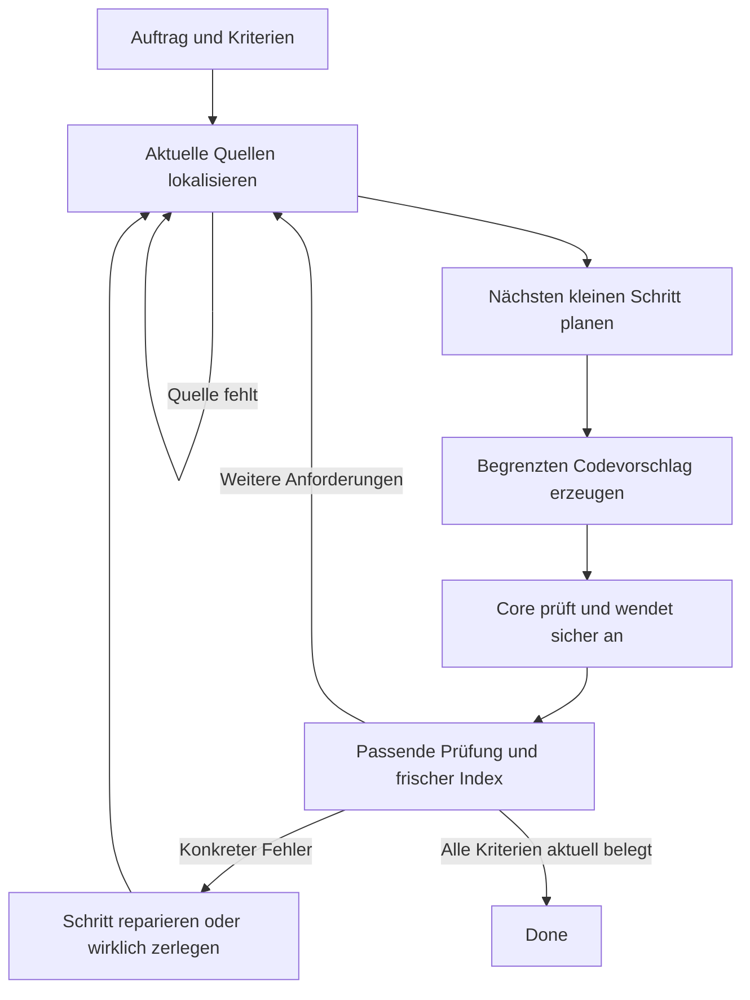

# A^3 Kleiner Agentenkern für lokale Modelle

Status: Angenommener Zielvertrag zu Plan 22; Umsetzung ab P0  
Stand: 2026-11-06

Das Ziel ist ein nutzbarer lokaler Assistent mit drei Arbeitsweisen: normal chatten, Fragen über das geöffnete Projekt beantworten und Codingaufträge in kleinen verifizierbaren Schritten ausführen. Der sichere Unterbau bleibt bestehen. Ersetzt wird die modellnahe Steuerung, die heute große Ersatzdateien, administrative Auswahlstufen und zu allgemeine Erfolgsnachweise verlangt.

Die Zielverträge sind mit Annahme von [ADR-0119](adrs/0119-kleinschrittiger-agentenkern-fuer-lokale-modelle.md) am 2026-11-06 verbindlich für neue Verträge. Der ausführbare Arbeitsplan steht in [Plan 22](plans/22-SMALL-LOCAL-MODEL-AGENT-CORE.md). Bestehende Sicherheitsinvarianten bleiben erhalten; der alte Produktionspfad dient bis P11 unverändert als Baseline.

## 1 Verantwortung von Core und Modell

| Der Core übernimmt                                             | Das Modell übernimmt in getrennten Aufrufen                                               |
| -------------------------------------------------------------- | ----------------------------------------------------------------------------------------- |
| Dauerhaftes Ziel, Kriterien, Constraints, Queue und Controller | Anforderungen eines begrenzten Auftragsteils verstehen und offene Entscheidungen erkennen |
| Datei-/Symbolauflösung, aktuelle Quellen, Liefernachweise      | Relevanten Code interpretieren und eine konkrete Quellenlücke benennen                    |
| Phasenwahl, bekannte IDs, Hashes, aktive Ressourcenlimits      | Nächsten kleinen Umsetzungsschritt und bei Bedarf seine Zerlegung vorschlagen             |
| Erhalt unveränderten Dateiinhalts, Konflikterkennung           | Code für einen begrenzten Änderungsbereich oder eine kleine neue Datei erzeugen           |
| Policy, Prozesse, Verifikation, Invalidierung und Recovery     | Eine technische Alternative innerhalb des Nutzerauftrags entscheiden                      |
| Nachweisstatus, Abschluss und öffentliche Aktivitätsprojektion | Eine quellengebundene Antwort oder verständliche Ergebnisdarstellung formulieren          |

Der Core kann nicht allgemein beweisen, dass ein Modell den Code richtig verstanden hat. Er kann aber verhindern, dass bloße Modellbehauptungen zu Facts, Freigaben oder abgeschlossenen Kriterien werden. Die Produktabnahme muss zusätzlich die tatsächliche Korrektheit der Antworten und Programme prüfen.

## 2 Drei getrennte Arbeitsweisen

### Chat

Chat funktioniert ohne geöffnetes Repository. Ein besessener, abbrechbarer Modelljob verarbeitet die Nutzernachricht und einen begrenzten Gesprächskontext. Es gibt keine Index-, Datei-, Prozess-, Netzwerk- oder Mutationswerkzeuge und keinen künstlichen Task oder Snapshot. Allgemeines Chatten benötigt keine erfolgreiche Coding-JSON-Probe. Providerstream, Outputgrenzen, Timeout und Cancellation bleiben erforderlich.

Ein geöffnetes Projekt wird nicht automatisch mitgelesen. Eine Frage nach dessen aktuellem Inhalt führt zu einem verständlichen Hinweis auf Ask; Chat darf keine vermeintlich geprüfte Projektantwort erfinden. Vom Nutzer eingefügter Code bleibt Gesprächsdaten und ist keine aktuelle Repositoryevidenz. Komprimierte Gesprächserinnerung bleibt als Zusammenfassung gekennzeichnet, ohne Faktstatus oder globale Projektmemory.

### Ask

Ask bindet das aktive geöffnete Projekt im Core und beantwortet ausschließlich dessen Inhalte. Projektfremde allgemeine Fragen werden kurz zum Chatmodus verwiesen. Ohne geöffnetes Projekt gibt es einen klaren Auswahlzustand statt eines erfundenen Kontexts. Ask besitzt weder Mutation noch allgemeine Prozess-, Netzwerk- oder Outside-Root-Fähigkeiten, auch nicht in Full machine.

Eindeutige Ziele werden zuerst gegen den aktuellen Index aufgelöst. Der gemeinsame Quellenlieferant stellt den nötigen Bereich und bei belegtem Bedarf Aufrufer, aufgerufene Funktion oder Writer bereit. Das Modell bearbeitet eine aktive Teilfrage. Bei mehreren Teilfragen erzeugt der Core eine geordnete Antwort aus getrennten Antworten und ihren ursprünglichen Quellenankern; Synthese darf keine neuen ungestützten Aussagen hinzufügen.

Eine Antwort unterscheidet Codebeobachtung, Interpretation und nicht prüfbare Laufzeitwirkung. Beispiel: Ein Funktionsname `save_tasks` belegt keine Speicherung; ein Tupelreturn muss als solcher beschrieben werden. Quellenlabels und wörtliche Zitate prüfen Herkunft, nicht automatisch die Wahrheit der Interpretation. Nicht vorhandene Belege führen zu einer konkreten Erkenntnisgrenze; nicht untersuchte Quellen werden nicht als Gegenbeweis behandelt.

Der erste isolierte Ask-Schnitt löst explizite Projektpfade und eindeutige
qualifizierte Symbole exakt im aktuellen Index auf. Die exakte Suche und der
sichere Leser müssen zur selben Publikation gehören. Mehrdeutige Treffer
liefern keine Quelle. Ohne geöffnetes Projekt oder passende Quelle bleibt der
Aufruf beim Core. Der sichere Leser liefert vollständige kleine Dateien oder
den ganzen verlangten Deklarationsbereich in Originalzeilen. Die Nennung
einer Deklaration hebt eine explizite Dateiauswahl nicht auf. Pro Job sind
bis zu vier Quellenfenster und pro Anfrage bis zu vier Jobs zulässig. Ask v1
nimmt bis zu sechs kurze Antwortteile mit
epistemischer Kennzeichnung und numerischen Referenzen auf die tatsächlich
gelieferten Fenster an. Doppelte oder fremde Referenzen und zusätzliche
Felder werden abgewiesen. Ein strukturell ungültiges Ergebnis kann einen
einzigen Repair innerhalb derselben Frist erhalten. Der Core prüft danach
alle gelieferten Seiten gegen den vollständigen Dateihash und verlangt
dieselbe Indexpublikation vor der Ausgabe.

Eine allein gelieferte Deklaration erhält einen kurzen Antwortjob. Eine
ausdrücklich auf den Rückgabewert beschränkte Frage bleibt bei dieser
Deklaration. Bei expliziten Aufruferfragen verfolgt der Core die aktuellen eingehenden
`Calls`-Kanten bis Tiefe zwei. Eine eindeutige Zieldeklaration bleibt auch
bei zusätzlicher Dateinennung der Anker. Eine mehrdeutige Zieldeklaration
löst keinen Modelljob über ein anderes Symbol aus. Der Core rendert die
statischen Aufrufpfade, wenn jedes Aufruffragment und die Zieldeklaration
durch tatsächlich gelieferte aktuelle Originalfenster gedeckt sind. Er
zeigt den Aufrufnamen aus der Quelle neben dem statisch gebundenen Ziel
und zitiert dessen Deklaration. Eine eindeutig gebundene Importkante kann
zusätzlich die passende unveränderte Originalzeile belegen. Eine weitere explizit benannte Deklaration
erhält ihre eigene Teilfrage und ihr eigenes Originalfenster, auch wenn
ihre Datei bereits in der Aufrufkette vorkommt.
Wenn dieser Körper ausschließlich das Ergebnis eines einfachen benannten
Aufrufs zurückgibt, wählt das Modell die Rückgabezeile. Der Core prüft sie
und benennt den sichtbaren Aufruf. Aussagen über fehlende Zielaufrufe
bleiben auf den Namen im gezeigten Körper begrenzt. Die Graphbelege tragen
die statische Zielbindung separat.

Direkte Projektimporte können kleine Originalmodule für die Untersuchung
liefern. Bei einer ausdrücklichen Ablaufverfolgung mit einem einzeln
gebundenen Einstiegspunkt zitiert der Core
dessen exakte aktuelle Deklaration einschließlich der sichtbaren Aufrufe
und Rückgaben. Ein direkt importiertes Symbol mit eindeutig gebundener
aufrufbarer Deklaration erhält einen eigenen Modelljob mit dem aktuellen
Importmodul. Der Modelljob erklärt nur den gezeigten Deklarationskörper.
Für andere direkte Importe erhält der Job Ausgangsdatei und Nachbarmodul
und muss die eigene Importquelle zitieren. Eine Importkante belegt keine
dynamische Laufzeitbindung.
Jedes aktuelle Originalfenster erhält vor der Modellarbeit einen Alias für
die gesamte Antwort. Ein Job erhält nur die eigenen Fenster und darf nur
deren Aliase ausgeben. Der Core setzt die Teile in Auftragsreihenfolge
zusammen und prüft die gelieferten Revisionen vor dem nächsten Modelljob
erneut. Die Messbelege trennen direkte Core-Beobachtungen
von den tatsächlichen Wire- und Nutzungsbelegen der Modelljobs. Die
Laufzeitwirkung bleibt von den sichtbaren Implementierungen und dem
statisch belegbaren Aufrufziel abhängig.

Bei einer Wirkungsfrage zu einer exakt gebundenen Deklaration kann ein
einzelner dynamisch unaufgelöster Aufruf eine enge Teilfrage auslösen. Das
Modell wählt die Originalzeile. Der Core prüft sie gegen die aktuelle
Aufrufstelle und formuliert die offene Laufzeitwirkung. Ein nachweisbares
Importziel bleibt im normalen Quellenpfad.

Eine ausdrücklich getrennte Frage nach Rückgabe und Wirkung zweier
Deklarationen erhält je einen begrenzten Auftrag. Eine ausgewählte
Zusatzquelle wird gegen denselben geöffneten Worktree und seine aktuelle
Publikation aufgelöst. Q06 liefert die eingefrorene `README.md` als
unprivilegierte Daten an den Wirkungsauftrag. Dessen Antwort zitiert nur
den gebundenen Deklarationskörper. Die Testbindung ergänzt die
unveränderte Originalfrage.

Für einen exakt gebundenen Python-Körper mit einer einzigen direkten
Rückgabe eines geschlossenen Datentupels genügt ein Zitatjob. Der Core
prüft die Rückgabezeile und beschreibt die sichtbare Rückgabe, ohne den
Inhalt eines Stringliterals als Speichermodus auszulegen. Eine Deklaration
mit Aufrufen, weiteren Anweisungen oder komplexen Ausdrücken behält ihren
Wirkungsauftrag.

Folgeantworten liefern ausschließlich aktuelle Originale an das Modell.
Wenn eine vorherige Antwort desselben Worktrees auf einer inzwischen geänderten
gelieferten Datei beruht, stellt der Core ihre betroffenen Antwortteile samt
ursprünglichen Ankern separat als Historie bereit. Der historische Text erhält
keinen neuen Quellenanker. Der Kandidat besitzt nur Index-, sichere Lese- und
Modellports. Die Anbindung an Sitzungsabschluss und Oberfläche folgt in P9.

### Agent

Agent benötigt ein gebundenes Projekt und einen dauerhaften Auftrag. Er kann in leeren und bestehenden Repositories arbeiten. Er darf selbst planen, innerhalb des Ziels technische Entscheidungen treffen, Dateien bearbeiten und geeignete Prüfungen anfordern. Ein obligatorischer vorgeschalteter vollständiger Rechercheplan entfällt. Recherche entsteht dort, wo ein konkreter nächster Schritt sie benötigt.

Eine neue Nachricht oder Modusauswahl übernimmt keinen laufenden Besitzer. Moduswechsel gelten für das nächste unabhängige Work Item; FIFO, Pause, Cancel, exakte Freigaben und Recovery bleiben Core-erzwungen. Planen ist eine sichtbare Tätigkeit im Agentmodus. Der Wunsch „erst planen, noch nicht ändern“ ist ein Constraint und verhindert Mutation bis zu einer ausdrücklichen späteren Umsetzungsauswahl.

## 3 Dauerhafter Auftrag und aktive Teilsicht

Goal Contract und Acceptance Criteria bleiben die Anforderungsautorität. Task Ledger und Journal bleiben Arbeits- und Ausführungsautorität. Keine zusätzliche zweite Todo- oder Wahrheitsdatenbank.

Der Intake erhält den vollständigen Originalauftrag und trennt Ergebnisanforderungen, Constraints, Nicht-Ziele, bereits entschiedene Vorgaben und echte offene Nutzerentscheidungen. Modellvorschläge tragen Referenzen auf die jeweiligen Originalteile; der Core erzeugt Identitäten und hält für jeden Auftragsteil fest, wo er zugeordnet wurde. Syntaktische Vollständigkeit ist noch keine semantisch richtige Anforderungsextraktion und wird in den Livefällen mitgeprüft.

Der vollständige Ursprung liegt unveränderlich und revisionsgebunden im bestehenden Goal-Store, gegebenenfalls als geordnete Originalteile mit typisierten Bereichsreferenzen. Die heutige 16-KiB-Grenze von GoalObjective und die 8-KiB-Kürzung im Materializer werden nicht für diesen Ursprung verwendet. Initial gilt eine ausdrückliche Grenze von 64 KiB UTF-8 pro Zielrevision mit höchstens 33 Teilen zu je 2048 Bytes; Mehrbytezeichen werden nicht getrennt. Übergröße führt vor Aufgabenstart zu einem erklärten Limit, niemals zu stiller Kürzung. Ein gelöschter Präsentationsverlauf entfernt diese Aufgabenautorität nicht. Das ist eine Erweiterung des Goal-Stores, keine zweite Anforderungsdatenbank.

P2 präzisiert die ursprünglich vorgesehenen 32 Teile auf 33: Ein Auftrag aus `a`,
16.383-mal `💡` und `bbb` besitzt genau 65.536 UTF-8-Bytes, aber bei Byte 2048
keine Zeichengrenze. 32 Teile müssten für diesen Gesamtumfang alle genau 2048
Bytes enthalten und würden ein Zeichen teilen. Der zusätzliche mögliche Teil
erhält Unicodegrenzen; weder Gesamtlimit noch maximale Teilgröße wachsen.
ADR-0119 legt das Gesamtlimit, keine feste Teileanzahl fest.

Ein zu langer Auftrag wird entlang seiner tatsächlichen Absätze/Listen in begrenzten Intakeaufrufen verarbeitet. Querverweise und widersprechende Vorgaben werden gesammelt, bevor Mutation erlaubt ist. Kein Abschneiden des Endes, keine Zusammenfassung als alleinige Autorität. Rückfragen entstehen bei fehlender Nutzerentscheidung oder widersprüchlichen Anforderungen; interne Dateisuche und technische Routineentscheidungen werden nicht an den Nutzer abgegeben.

Ein einziges Finding kann die Randbytes des zugestellten Fensters mit abdecken.
Der Core prüft dafür zuerst ein exaktes, eindeutiges Zitat und verlangt außerhalb
des Zitats ausschließlich ASCII-Leerzeichen, Tab, CR oder LF. Er behält diese
Randbytes bytegenau in der Quellenzuordnung. Ein vorhandener Nachweis erlaubt
die Erweiterung nur, wenn sein Bereich bereits dem ganzen Fenster entspricht.
Rückfragen behalten ihre exakten Zitatbereiche. Ein Finding erfordert weiterhin
zitierbaren Inhalt, und die Gesamtdeckung prüft jedes Originalbyte.

Jeder aktive Modellauftrag enthält:

- das aktuelle Teilziel mit seinen konkreten Acceptance Criteria und ursprünglichem Auftragsbezug;
- alle global geltenden sowie für den Schritt relevanten Constraints und Nicht-Ziele;
- Controllerphase, kompakte aktuelle Verifikationslage und unveränderliche Bindung an Ziel-/Ledgerrevision;
- den relevanten offenen Fehler mit tatsächlicher Diagnose;
- eine größenbegrenzte Projektion der Gesamtabdeckung als Zähler, Digest/Revisionsbindung und aktuell relevante Kriterienaliase; die vollständigen Listen mit offen, in Arbeit, nachgewiesen oder stale bleiben dauerhaft und werden beim Planen paginiert;
- aktuelle, tatsächlich gelieferte Originale und eindeutige begrenzte Referenzen.

Ein Constraint darf nur dann aus einer Teilsicht fehlen, wenn seine Nichtanwendbarkeit typisiert feststeht. Unklare globale Regeln bleiben aktiv. Nicht gelieferte Anforderungen bleiben dauerhaft offen und werden später einzeln eingeplant. Vor Done rekonstruiert der Core die gesamte Abdeckung aus Originalauftrag, Kriterien, Ledger und Nachweisen. Ein Modell darf keine Anforderung durch Weglassen erledigen.

## 4 Ein Controller und kleine Phasenaufträge

Die groben Zustände aus ADR-0010 bleiben: Intake, Localize, Plan, Execute, Verify, Replan, AwaitApproval und terminale Zustände. Die folgende Darstellung zeigt Unterarbeit desselben Besitzers, keine zweite Zustandsmaschine:



Jede Schleife besitzt Runbudget, Timeout, Cancellation und Fortschrittsprüfung. Vor Toolbeginn liegt dieselbe zentrale Policygrenze. Ein AwaitApproval beendet die fachliche Arbeit nicht und zählt nicht als Fortschritt oder Misserfolg des Modells.

Die Modellgrenze hat wenige eigenständige, versionierte Ausgabefamilien. Konkrete Typnamen werden erst beim ersten Verbraucher eingeführt:

| Auftrag                    | Begrenzter Modelloutput                                                          | Coreentscheidung                                      |
| -------------------------- | -------------------------------------------------------------------------------- | ----------------------------------------------------- |
| Intake eines Originalteils | Ergebnisanforderung, Constraint oder echte offene Entscheidung mit Originalbezug | Zuordnen, Widerspruch prüfen, Kriterien revisionieren |
| Nächster Schritt           | Ein Ergebnis, benötigter Code, betroffene Schnittstelle, Prüfabsicht             | Abdeckung, Größe, Reihenfolge und Scope prüfen        |
| Quellenlücke               | Fehlendes Symbol/Bereich/Beziehung aus gelieferten Kandidaten                    | Sicher auflösen und lesen oder Grenze erklären        |
| Vorhandenen Code ändern    | Ersatztext oder geschlossene Quellen-/Größenmeldung                              | Antwort an den Core-Job binden, exakten Edit kompilieren und Policy ausführen |
| Neue Datei                 | Kleiner vollständiger Inhalt oder Größenmeldung                                  | Ziel und Scope prüfen, Add ohne Ersetzen erzeugen     |
| Ask antworten              | Begrenzte Aussagen mit Quellenreferenzen und offenen Grenzen                     | Provenienz/Freshness prüfen, sichere Darstellung      |

Der Core ruft nicht das Modell auf, um einen bereits feststehenden Command, eine bekannte ID oder die nächste deterministische Zustandskante nochmals auswählen zu lassen. Modellentscheidungen bleiben dort, wo echte fachliche Alternativen bestehen.

Planung arbeitet zunächst mit höchstens fünf groben Ergebnisgruppen und höchstens drei konkret vorbereiteten nächsten Umsetzungsschritten. Nur der unmittelbar nächste Schritt erhält Code und ausführbare Ressourcen. Diese Werte sind initiale Policygrenzen, keine aus Modellnamen abgeleiteten Fähigkeiten. Offene Anforderungen dürfen größer als dieser Horizont sein und bleiben im dauerhaften Abdeckungsstand. Ziel ist fortschreitende Planung statt eines riesigen Vorabplans.

Ein Core-Angebot kann eine bereits feststehende Voraussetzung zu einem
anderen Angebot tragen. Der Core ergänzt diese Kante bei der Übernahme und
lehnt eine Auswahl ohne das benötigte Angebot ab. Das Modell entscheidet
über Schrittziele und kann zusätzliche fachliche Kanten vorschlagen.
Unabhängige Angebote erhalten aus ihrer Reihenfolge keine Abhängigkeit.

Für genau ein ausdrücklich als mögliche `Add`-Operation vorbereitetes
Dateiziel im leeren publizierten Index verwendet der Kandidat einen kleinen
Planauftrag v3. Das Modell erhält Operation und exakten Zielpfad zusammen
mit dem unveränderten aktiven Originalauftrag. Es entscheidet mit
`decision: "add"`, `decision: "refuse"`, `decision: "clarify"` oder
`decision: "tooLarge"`. Alle vier Ergebnisse verwenden dasselbe strikte
Objekt mit genau `decision`, dem gebundenen `job` und `version: 3`.
Damit wird die Ergebniswahl erst durch den Wert des gemeinsamen Felds
getroffen; verschiedene Pflichtfeldnamen wählen keinen Objektzweig vorab.
Der unabhängige Decoder akzeptiert jede Feldreihenfolge und weist fremde,
doppelte, fehlende oder nullwertige Felder sowie v1/v2-Ausgaben ab.
Es muss keine freie Schrittbeschriftung erzeugen. Ein fachlicher Halt ist
ein gültiges, abgerechnetes Dokument und eröffnet keinen Strukturrepair.
Es gibt weder eine voreingestellte Add-Wahl noch eine automatische Auswahl nach
fehlgeschlagener Antwort. Andere Planaufträge bleiben beim bestehenden
allgemeinen Modellplanvertrag.

Die Auswahl ist eine Planentscheidung des Modells. Sie beweist keinen
ausdrücklichen Nutzer-Create-Auftrag; Prüfrezept und Schreibfreigabe ersetzen
diesen ebenfalls nicht. Original und Constraints bleiben maßgeblich.
Der Core erzeugt erst nach der tatsächlichen Wahl die konkrete Anzeige
`Create <Ziel>`. Operation und Ziel bleiben zusätzlich als typisierte
`PlannedFileAddition` erhalten und werden nie aus dieser Anzeige gelesen.
Die Bindung verlangt einen identischen Singleton-Diff mit `ExactPaths`.
Ein so gebundener Editauftrag darf ausschließlich Add am gewählten Ziel
vorbereiten. Update, Append, fremdes Add und ein Verlust der Bindung sind
vor Provider-I/O abzuweisen. Job-/Fensteranker und die aktuelle dauerhafte
Ledgerdefinition werden hierfür unabhängig abgeglichen.

Der isolierte Datenbestand v59 speichert die Add-Bindung und den fachlichen
Halt samt Referenz auf die beobachtete Planreservierung. Presence-Marker und
typisierte Rekonstruktion verhindern einen stillen Some/None-Fallback nach
partiellen oder beschädigten Daten. Ledger-CAS beziehungsweise Settlement
halten Metadaten und Elternzustand atomar. Positive tatsächliche Usage,
ursprüngliche Frist und verbrauchte Budgets bleiben unverändert; ein Halt
materialisiert keinen Ledger oder Run. Es entsteht kein Nulltoken-Planweg.
Ein aktueller Halt ist nach kaltem Reopen typisiert lesbar. Schema 42 und
das Produktionswiring bleiben die eingefrorene Baseline; alte
Entwicklungsdaten werden nicht in v59 importiert.

Bei einem aktuellen publizierten Index ohne Dateirevisionen übergibt der
Core `inventory: "emptyPublishedIndex"` und `source: null`. So kann die
Planphase aus Anforderungen und Core-Angeboten einen begrenzten
Erstellungsschritt vorschlagen. Die Bestandsaufnahme bezieht sich auf
den gebundenen Indexlauf und Snapshot. Der Core prüft den Leerstatus
beim erneuten Laden der Publikation. Eine fehlende Publikation ist
ein veralteter Zustand. Bei einem dateihaltigen Index bedeutet
`source: null` lediglich, dass keine Quellseite bereitgestellt wurde.

Wenn alle aktuell materialisierten Schritte abgeschlossen sind, prüft der Core zuerst die globale Kriterienabdeckung. Offene noch nicht eingeplante Anforderungen führen innerhalb desselben Runs von Verify nach Plan. Eine atomare Ledger-/Journal-CAS hält den Zustand „nächste Planung ausstehend“, die offenen Kriterien, den erreichten Horizont und alle verbrauchten Budgets. Der nächste begrenzte Planaufruf hängt echte neue Schritte an; kein neuer Run und kein Budgetreset. Recovery kann an dieser Grenze ohne doppelte Mutation fortsetzen. Erst vollständige globale Abdeckung erlaubt ReadyForAcceptance. Eine Ask-Antwort oder ein leerer momentaner Arbeitshorizont darf diese Kante nicht ersetzen.

Plan- und Editphasen besitzen je nach aktuellem Bestand eine kleine typisierte Alternative für fehlende Evidence beziehungsweise einen zu großen Auftrag. Ein Edit-Add bei leerem publiziertem Index erlaubt als Alternative nur `tooLarge`; die vorgeschaltete ausdrückliche Planwahl hat die oben beschriebenen vier Entscheidungen. Eine zugelassene fachliche Rückgabe ist kein Strukturfehler. Sie erzeugt keine Mutation und führt im selben begrenzten Controller zu Localize oder einer engeren Planrevision. Das Modell muss weder einen unsicheren Patch noch absichtlich ungültiges JSON liefern, um eine beim Schreiben erkannte Lücke zu melden. Diese Alternativen zählen vollständig gegen denselben 4k-Vertrag und dieselben äußeren Budgets.

## 5 Quellenlieferung und große Dateien

Der vorhandene Fast Index bleibt der einzige Index. Exact, Lexical, Graph/Test und Task Lens bleiben die geordnete Kandidatensuche. Deep Map, Embeddings und Atlas sind keine Startvoraussetzung für Chat, Ask oder Agent. Wenn vorhanden, dürfen aktuelle Cards Navigation ergänzen; sie ersetzen kein Original für die konkrete Änderung.

Der Lieferant verwendet konkrete Aufgabe und Scope statt pauschalem Top-k. Er versucht zuerst den benannten Zielbereich, dann aktuelle Signatur/Rumpf, anschließend erforderliche belegte Nachbarschaft. Ein 1.000-Zeilen-Modul wird nicht automatisch vollständig geladen. Eine große Funktion kann in nachvollziehbare zusammenhängende Teilbereiche mit Signatur-/Kontrollflusskontext zerlegt werden; fehlende Abhängigkeiten bleiben als Lücken sichtbar.

Pro Bereich werden Dateirevision, Quellbereich, tatsächliche Lieferung und Fortsetzungsposition festgehalten. Wiederholungen unveränderter Bereiche ohne neue Frage sind kein Fortschritt. Ein leeres Suchergebnis ist keine gelieferte Implementierung. Ein größerer Quellenbedarf führt zu einer weiteren begrenzten Quellenscheibe oder einer engeren Aufgabe, nicht zu erzwungenem Patchen.

Initiale Sicherheitsobergrenzen für den neuen begrenzten Schritt sind acht tatsächliche Erwerbsaktionen, zwei aufeinanderfolgende erfolglose Aktionen ohne neue aktuelle Bereiche und genau eine Core-Neulokalisierung derselben Lücke. Die Werte werden vor dem Vergleich als Policyversion eingefroren. Erschöpfung erzeugt eine typisierte Grenze mit Suchumfang und fehlendem Beleg. Sie behauptet niemals Evidenzsuffizienz und erneuert kein äußeres Runbudget.

Für direkte Aufrufer bindet die Neulokalisierung eine eingehende `Calls`-Suche
an die aktuelle Deklaration, die das Editfenster tatsächlich bearbeitet. Ein
Treffer liefert nur Kandidaten für einen separat zugelassenen Original-Read.
Die Suche zählt auch ohne Treffer oder nach Unterbrechung. Hat die vorherige
Erwerbsaktion ebenfalls keine neuen aktuellen Bereiche geliefert, kann bereits
die Suche die Grenze von zwei solchen Aktionen erreichen. Für eine Pflichtquelle
mit Rolle Caller muss die gerichtete Aufrufkante zur bearbeiteten Deklaration
belegt sein. Ein kleines Teilfenster in einer großen Funktion genügt dafür.

Read-only Toolergebnisse und gelieferte Codefenster bleiben flüchtige Quellen. Dauerhaft werden ihre erlaubten Evidenceanker, Grenzen, Ergebnisse und Hashbezüge gehalten. Nach Neustart werden benötigte Originale über denselben sicheren Reader erneut geholt und geprüft.

## 6 Präzise Edits statt vollständiger Dateiausgabe

Ein dauerhaft erfasster Zielread kann über das bestehende
`with_required_source(Definition, ...)` an den Edit gebunden werden. Bound,
aktueller Owner-Scope, erworbener Stamp und Originalseite müssen zusammenpassen;
die Seite muss exakt dem bereits gepackten Replace-Fenster entsprechen. Der
Request erhält keine zusätzliche Quellkopie. Ein privater Quellen-Enum hält
entweder diese Zielbindung oder die bestehende gerichtete Callerbindung.
`source_delivery` bezeichnet die eine tatsächlich beobachtete Wirelieferung.
Initial und einzelner Repair behalten denselben Stamp und verwenden die vorhandene
transaktionale Reservierung samt Source-Read-Key.

Dieser erste Anschluss unterstützt vollständige Replace-Seiten. Ein vom Fenster
entfernter BOM-Präfix darf nicht als geliefert gutgeschrieben werden: Der bestehende
kalte Replay speichert die vollständige erworbene Originalrange. Append und Add
bleiben außerhalb dieses ersten Bindungsscope; Append-Kontext ist dadurch nicht
grundsätzlich unlieferbar. Bestehende ungestempelte und Callerpfade bleiben erhalten.
Nach Provider-I/O wird eine gebundene Zielseite auch vor NeedEvidence/TooLarge
erneut live geprüft; eine inzwischen fremd geänderte Datei liefert keinen
akzeptierten aktuellen Zielbeleg. Es gibt weder einen künstlichen Caller noch
ein Abandon des pending Reads zur Umgehung der Reservierungsgrenze.

Für eine vorhandene Datei erzeugt der Core ein einmalig gebundenes Editfenster. Dieses umfasst vollständige Ausgangsbytes eines kleinen zusammenhängenden Bereichs, die zugehörige aktuelle Dateirevision und nötigen verständlichen Kontext. Im aktuellen Kandidatenvertrag Edit V3 erhält das Modell `version: 3`, die Core-bestimmte Operation `replace`, `append` oder `add` und `current` als Ausgangscode. Die Antwort enthält ausschließlich die fachliche Ausgabe, beispielsweise:

```json
{ "code": "    return value + 1\n" }
```

Version, Job und Fenster sind Core-Bindungen und müssen nicht vom Modell wiederholt
werden. Die Core-eigene Antwortbindung ordnet begrenzte Providerbytes dem konkreten
Protokoll und Job zu; eine Antwort aus einem anderen vorbereiteten Fenster darf
nicht als Antwort für dieses Fenster kompiliert werden. Diese Bindung ist weder
Modellinhalt noch Approval. Projekt, Goal, Ledger, Run-Ereignisposition, aktiver
Versuch, Spec, Snapshot, vollständiger Dateihash, Bereich und exakte Ausgangsbytes
bleiben Bestandteil der internen Bindung und ihrer Live-Revalidierung.

Ausgangsfenster und roher decodierter Ersatztext sind jeweils auf 8 KiB UTF-8
begrenzt. Das Modell antwortet mit genau einem strikten JSON-Objekt und einem
Payloadfeld. Doppelte oder unbekannte Schlüssel, `version`, `window`, das alte
`replacement`, freie Pfade, Offsets, ganze Patch-Actions und zweite Ersetzungen
werden abgewiesen. Es gibt keinen V1-Fallback. Der V1-Aliasvertrag bleibt in den
eingefrorenen P0-/P3- und Modellartefakten reproduzierbar. Die vollständige
Provideranfrage einschließlich Initial, Strukturrepair und Abbruchrepair wird am
tatsächlich codierten Wire gegen das unveränderte Profil geprüft.

Die aktive Editansicht wird deterministisch als kompakter Text gerendert. Sie
übernimmt die vollständigen Texte des aktuellen Schritts, seiner aktiven
Addresses-/Proves-Kriterien, aller möglicherweise geltenden Constraints,
Nichtziele und Nutzerentscheidungen unverändert. Globale Abdeckungszähler,
relevante vorherige Fehlschläge und die aktuelle Diagnose bleiben enthalten.
Nicht verfügbare aktuelle Issues bleiben von einer nachweislich leeren Liste
unterschieden. Diese Darstellung ersetzt weder den vollständigen Originalauftrag
noch seine revisionsgebundene dauerhafte Autorität.

Bei einem nichtleeren Replace für ein vollständiges inneres Zeilenfenster erhält
der Core dessen vorhandene abschließende Zeilentrennung: Beginnt das aktuelle
Fenster am physischen Zeilenanfang (einschließlich direkt nach UTF-8-BOM), endet
es mit LF beziehungsweise CRLF und folgen unveränderte Dateibytes, ergänzt der
Core bei fehlendem abschließenden kanonischen LF genau ein LF vor der bestehenden
EOL-Konvertierung. Außenbytes werden nicht geändert oder neu gesucht. Leerer
Ersatz, EOF, Teilzeilen, Add und Append behalten ihre bisherigen Bedeutungen.
Die Grenze von 8 KiB gilt unverändert für die rohen UTF-8-Modellbytes vor
Normalisierung; der fest bestimmte Core-Separator ist keine zusätzliche
Modellausgabe. Die bestehenden Grenzen des vollständigen Patchs bleiben bestehen.
Dies bestätigt ausschließlich die Bytegrenze und ersetzt keine Syntax- oder
Funktionsprüfung.

Alternativ zum Ersatztext erlaubt derselbe Core-Job `"tooLarge":true` und
bietet `need` ausschließlich für eine tatsächlich gebundene vollständige
Definition oder einen belegten Caller an. Test ist ohne Testresolver kein
lieferbares Angebot. Eine trotzdem eintreffende reguläre Need-Antwort bleibt
ein typisierter, nicht mutierender Halt; unbekannte Neednamen werden als
`Unknown` gehalten. Der kalte Receipt beschreibt die Modellanfrage, ohne eine
Quellenlücke als Projektfakt zu bestätigen. Ein solcher Halt eröffnet weder
automatische Quellenbeschaffung noch Datei-/Prozesszugriff oder Strukturrepair.

Für einen Add-Auftrag bei einer tatsächlich leeren aktuellen Publikation
liefert der Core zusätzlich `inventory: "emptyPublishedIndex"` und leere
Ausgangsbytes. Das Modell liefert entweder
`code` als begrenzten LF-Dateiinhalt oder `tooLarge`. Das Schema enthält
in diesem Fall keine `need`-Variante. Eine dennoch regulär eintreffende
Need-Antwort bleibt auch hier ein typisierter semantischer Halt ohne Repair,
Quellencredit oder automatische Beschaffung. Bei einem dateihaltigen Index gilt ebenfalls ausschließlich das tatsächlich
gebundene Rollenangebot; der Bestand allein bietet keine Quelle an.
Die Auswahl verändert weder Originalauftrag noch aktive Kriterien,
Constraints, Nichtziele oder Nutzerentscheidungen. Der Leerstatus beschreibt
die publizierten Dateirevisionen und ersetzt nicht die Live-Abwesenheitsprüfung
des Add-Ziels durch E3.

Der Leerstatus gehört zum `EditPhaseAnchor` und zum Fenster-/Jobdigest
`a3 edit phase window v3`. Er bindet damit die konkrete
Anfrage an die geprüfte Bestandsaufnahme. Die Reservierung prüft innerhalb
der bestehenden Storetransaktion den aktuellen Run, Goal, Ledger, Snapshot
und das tatsächliche Vorhandensein publizierter Dateirevisionen erneut,
bevor ein Provideraufruf zugelassen wird. Gleiche IDs bei anderem Leerstatus
genügen nicht. Die Bindung verwendet die bestehenden Datenstrukturen und
Tabellen; für Edit V2 mit HTTP-Plan V4 gilt der frische Kandidatenbestand V65 ohne Übernahme
älterer Entwicklungsdaten. Die Versionsgrenze ändert weder bestehende Tabellen
noch die eingefrorene Produktionsbaseline.

Endet der Provider mit bestätigter Ausgabegrenze und plausiblen positiven
Tokenzahlen, verwirft der Core den Teiloutput. Der Auftrag erlaubt höchstens
einen Strukturrepair mit dem vollständigen ursprünglichen Kontext, demselben
Schema und der ursprünglichen Frist. Der feste Repair-Hinweis fordert ein
kürzeres vollständiges Objekt. Fehlende oder null gemeldete Terminalzahlen
lassen den Aufruf als Unknown belastet und öffnen keinen Repair.

Eine vom Core bereits gebundene Pflichtquelle muss vor der Editanfrage als
aktuelle Originalseite vorliegen. Fehlt sie, meldet die Request-Zulassung die
typisierte Quellenlücke vor der Provider-Reservierung. Eine unabhängig
nachgewiesene Mindestgröße oberhalb der Ersetzungsgrenze stoppt ebenfalls in
der Zulassung. Für neu erkannte Lücken bleibt die reguläre Modellausgabe
verfügbar. Gelieferte read-only Quellen erweitern das editierbare Fenster
um keine Bytes.

Der Core liest die vollständige Datei über den bestehenden sicheren Pfad, prüft Hash und Bereich, ersetzt ausschließlich die gebundenen Bytes und erstellt den bestehenden `PatchUpdate`. Der gesamte Effekt einschließlich außerhalb des Fensters unveränderter Bytes wird vor Preview geprüft. Danach gelten unverändert Policy, exakter Fingerprint, einmalige Autorisierung beziehungsweise aktuelle Full-machine-Revision, Mutationslease, Revalidierung, Workspaceadapter, Change Set und atomarer Reindex.

[ADR-0120](adrs/0120-positionsgebundene-patchvorschau.md) ermöglicht im Kandidaten die
Anzeige des wirklichen Änderungsausschnitts auch hinter dem alten Dateipräfix. E3 prüft
die bytegleichen Außenteile und liefert vollständige geänderte Zeilen mit absoluten
Koordinaten. Eine zu große Änderung hält vor der Freigabe an. Die exakte Vorschau bleibt
flüchtig und an Action und Snapshot gebunden.

Meldet die Vorschau bei einem aktuellen Original-gebundenen Run einen
Livekonflikt, beendet der Kandidat den Schrittversuch und den Run atomar über
Ledger und Journal. Der Schritt hält den geschlossenen Konfliktcode. Der
Vorschaufehler erreicht den Aufrufer vor einer neuen Policyentscheidung.
Der Halt erzeugt keinen Werkzeugversuch und keine erneute Modellanfrage.

Encoding und eine vorhandene UTF-8-BOM sind Core-eigene Dateimetadaten außerhalb des editierbaren Textfensters. Die BOM bleibt auch beim Edit der ersten Zeile erhalten. CRLF/LF außerhalb des Fensters bleiben bytegleich. Intern verwendet Ersatztext die vorab erklärte kanonische LF-Darstellung. Nach der unveränderten Grenze der rohen decodierten UTF-8-Bytes kanonisiert der Core ausschließlich eingehende CRLF-Paare einmal zu LF; vorhandene LF bleiben erhalten. Danach bildet er die LF-Darstellung genau einmal auf die explizit gebundene EOL-Konvention ab. Ungepaarte CR-Zeichen, BOM und andere unerlaubte Steuerzeichen im Ersatz sowie mehrdeutige gemischte EOL-Quellfenster bleiben abgewiesen. Quellbytes werden dabei weder normalisiert noch geraten. Unicodegrenzen müssen gültig sein. Keine Fuzzysuche, globale Zeichenkettenersetzung, stilles Hash-Rebinding nach Liveänderung oder Übernahme fremder Bytes ohne neuen Turn.

Mehrere zusammengehörige Fenster können vom Core als ein begrenzter Patchbatch geprüft werden. Modellaufrufe bleiben einzeln klein; eine zwischenzeitliche Dateiänderung macht die gesammelten Vorschläge stale. Vorschläge ohne tatsächliche Wirkung werden als NoChange behandelt, nicht zur Wiederholung eines bereits angewandten Patches aufgefordert. Sie belegen keine Umsetzung.

Neue Dateien beginnen mit einem kleinen sinnvollen, möglichst syntaktisch vollständigen Gerüst. Größere Dateien wachsen danach über dieselben exakten Insert-/Replacefenster; ein EOF-Insert ist an den aktuellen gelieferten Dateischluss und Hash gebunden. Keine allein wegen Kontextmangel erzwungene Modulaufteilung. Die zugehörige Anforderung bleibt bis zur integrierten Prüfung offen. Bei ausdrücklich verlangter atomarer Erzeugung eines zu großen Einzelartefakts wird diese Fähigkeit nicht vorgetäuscht; ein späterer begrenzter Builder benötigt einen konkreten blockierenden Fall und eigene Abnahme.

## 7 Passende Verifikation und ehrlicher Abschluss

Die Kriterienzuordnung wird vor der Umsetzung pro Ergebnis festgelegt und bei neuen Erkenntnissen revisioniert. Vorhandene `VerificationSpec`-, Evidence- und Acceptance-Prüfer werden weiterverwendet; erweitert wird ihre inhaltliche Zuordnung und Abdeckungsprüfung.

| Behauptung                                 | Geeigneter Nachweis                                                                         | Reicht allein nicht                                          |
| ------------------------------------------ | ------------------------------------------------------------------------------------------- | ------------------------------------------------------------ |
| Gewünschte Dateiänderung vorhanden         | Exakte Diff-/Dateiinvariante auf aktuellem Snapshot                                         | Modelltext, irgendeine andere geänderte Datei                |
| Funktion liefert das geforderte Verhalten  | Gebundener vorhandener Test oder kurze operationale Funktionsprüfung mit passenden Eingaben | Lint, erfolgreicher Build, ein einziges unpassendes Beispiel |
| APIänderung integriert                     | Aufrufer-/Definitionsabdeckung plus passende Sprach-/Verhaltensprüfung                      | Nur callee geändert oder nur Dateien gezählt                 |
| HTTP-Server funktioniert                   | Tatsächlicher Start und begrenzte Requests einschließlich geforderter Fehlerfälle           | Python kompiliert, Prozess konnte gestartet werden           |
| Reine Dokumentationsänderung abgeschlossen | Angefragter Inhalt, Scope-/Diffprüfung und vorhandene Linkprüfung                           | Unnötig erzwungene Laufzeittests                             |

Bei neuen Features mit zunächst grünen Checks muss trotzdem eine aktuelle passende Änderung oder ein belegter AlreadySatisfied-Fall vorliegen. Ein unverändert grüner Linter kann keinen Implementierungsschritt abschließen. Bestehende fehlgeschlagene Checks werden vorab erfasst; fachfremde Altfehler werden nicht verschwiegen und nicht ungefragt repariert.

Eine Prüfung besitzt ein konkretes Ziel, einen bestätigten Command oder ein geschlossenes Core-Rezept, CWD, beobachtete Ergebnisse und Grenzen. Testprozesse müssen tatsächlich die vorgesehenen Tests ausführen; null gefundene Tests sind kein positiver Testnachweis. Ein automatisch entdeckter erster Command ist nur ein Kandidat. Modellvorschläge für Prüfabsichten erhalten keine freie argv-Ausführung.

Die produktiven Evidence-Erzeuger werden ausdrücklich implementiert, nicht durch das externe Eval-Orakel ersetzt: bestätigte vorhandene Test-/Build-/Lintcommands, ein begrenztes lokales CLI-Ein-/Ausgaberezept und ein Start-/HTTP-/Stop-Rezept für einen freigegebenen lokalen Dienst. Jedes Rezept besitzt exakte ProcessSpecs beziehungsweise geschlossene Parameter, erwartete Beobachtungen, Outputgrenzen, eine Gesamtfrist, Cancellation und einen besessenen Cleanup-/Joinpfad. HTTP bleibt an das ausdrücklich gebundene Loopbackziel gebunden; Startup und Requests durchlaufen dieselbe aktuelle Policy. Ein unbekannt weiterlaufender Dienst wird als Unknown behandelt, nicht erfolgreich abgehakt. Die erzeugte Evidence belegt nur die beobachteten Fälle und darf kein freies Modellprädikat zur Wahrheit erklären.

Die HTTP-Ausführungsgrenze verwendet eine explizite Startfreigabe und
je eine Freigabe pro Methode und Pfad. Der Adapter prüft `127.0.0.1`,
Port, Listener und die serverseitige Hälfte der gehaltenen Verbindung
gegen den direkt gestarteten Prozess, bevor er HTTP-Daten sendet.
Er verwendet den HTTP/1-Parser aus dem bereits gepinnten Hyper-Stack
auf genau diesem Socket. Die Beobachtung enthält Status, begrenzte
Headermerkmale, Bodylänge und Bodyhash. Windows verwendet die kanonische
Systemwurzel für die einzige im Start erlaubte Umgebungsvariable
`SYSTEMROOT`. Das nach [ADR-0122](adrs/0122-besessener-windows-job-fuer-loopback-pruefungen.md)
begrenzte Windows-Modul ordnet den Prozess bei der Erzeugung einem
privaten Job mit Kill-on-Close zu und liest die numerische
TCP-Owner-Tabelle direkt. Linux liest die Prozess- und Socketdaten
aus `/proc`. Der Transportbeleg verlangt die beobachtete leere
Prozessgruppe oder den leeren Windows-Job und den verschwundenen
Listener. Die Skriptrevision wird vor Start und nach Stop geprüft.

Der Linux-Adapter entsorgt nur die vorab als besessen geprüfte private
Probeverbindung beim Scopeende mit einem TCP-Reset. Die vorhandene sichere
Tokio-Option `set_zero_linger` und Hypers `poll_without_shutdown` verhindern einen
vorangehenden FIN, der sonst den eigenen unverändert exklusiv und ohne Reuse
gebundenen Rezeptport in `TIME_WAIT` halten kann. Die Logik liegt im bestehenden
Linux-Modul; HTTP-Bodyverarbeitung und der übrige Plattformpfad behalten ihre
Verträge. Ein `TIME_WAIT`-Socket ohne Listener ist kein fremder laufender Dienst.
Das erlaubt weder einen fremden Kill noch Portwechsel, Sleeps oder gelockerte
Bindungs-/Freigaberegeln als Ersatz für den Nachweis.

Die Verbindungsentsorgung erzeugt selbst keine positive Evidence. Der vollständige
korrekt gerahmte Body muss unter den bestehenden Header-/Body-/Zeitgrenzen gelesen
sein. Teilantworten, Fehler und Abbruch bleiben erfolglos. Die besessene
Prozessgruppe wird davon unabhängig gestoppt und vollständig beobachtet; erst mit
passendem vollständigem HTTP-Beleg, verschwundenem Listener und gültigem aktuellem
Skripthash kann die vorhandene Verifikation schließen. Der Reset ersetzt keinen
dieser Nachweise.

Der HTTP-Vertrag bindet die Startform, den Port und die geordneten
Sollantworten an den Originalbereich und die Verifikationsspezifikation.
Die in V57 gebundene Startabdeckung fasst den expliziten Start,
den Standardstart mit einem ausgewählten erfolgreichen GET und
die beiden Fehlerexits in demselben Rezept zusammen. V58 führt dieses
Rezept im isolierten Kandidaten über denselben Mutationscontroller aus.
Eine eigene exakte Freigabe erlaubt die besessene Portreservierung;
getrennte Phasenfreigaben binden den gehaltenen und freien Start trotz
identischer argv. Es folgen die geordneten expliziten Proben, der
Standardstart mit GET und der Start mit ungültigem Portargument.
Alle Freigaben werden vor dem ersten Bind oder Start konsumiert.
Eine gemeinsame Gesamtfrist umfasst alle Phasen mit eigener Cleanupreserve.
Der Adapter bricht bei falschen Beobachtungen nach besessenem Cleanup ab.
Ein regulärer Fehlerexit muss im Bereich 1 bis 255 liegen.
Der gesamte Ablauf hat einen einzelnen dauerhaften Unknown-Versuch und
einen atomaren Abschluss mit vollständigem Beleg. Eine bekannte beendete
Teilwirkung bleibt Applied ohne vollständigen Beleg; nicht nachgewiesenes
Ende bleibt Unknown. Die vollständige A04-Modellabnahme bleibt offen.
Das HTTP-Paket ist für den aktuellen Änderungsstand erneut geöffnet;
die dafür erforderlichen Großgates sind noch nicht abgeschlossen.
Eine Probenfreigabe bindet zusätzlich Snapshot, Skriptrevision und
die genaue Position im Rezept. Jede Methode bleibt explizit
freigabepflichtig. Die Workspace-Regeln für Lesen, Schreiben oder
destruktive Wirkungen gelten entsprechend der Methode auch dann,
wenn der Auftrag eine ablehnende HTTP-Antwort erwartet. Eine DELETE-Probe
hat die primäre Klasse `Destructive` mit Risiko `Critical`; die zusätzlichen
Restriktionen `Network` und `Write` bleiben wirksam. Die übrigen Methoden
behalten `Network`/`High` mit zusätzlicher Read- beziehungsweise
Write-Restriktion. Ask permissions und Full machine verlangen weiterhin
eine exakte Einmalfreigabe für jede Probe. Eine Workspace-Ablehnung jeder
beteiligten Wirkung hat auch bei vorhandenem Grant Vorrang. Diese Korrektur
ändert weder Aktionsparameter noch Fingerprint-/Scope-Digest-Kodierung oder
DDL-Verträge. Der Decoder
in V56 akzeptiert HTTP-Evidence nur mit einem dazu passenden dauerhaften
Toolabschluss und den vorangehenden exakten Policyentscheidungen.
Der Plan erhält ein Core-Angebot mit der Prüfart `http` und der
zugehörigen Originalpflicht. Das Modell formuliert eine kurze
einzeilige Ergebnisbeschreibung. Antwortbytes und erwartete
Headermerkmale bleiben im typisierten Rezept. Der Decoder weist
Steuerzeichen, Anführungszeichen und Backslashes in der Ergebnisbeschreibung
ab, auch wenn die JSON-Form gültig ist. Dasselbe begrenzte Zeichenformat
steht im Providerschema; gewöhnliches Unicode bleibt erlaubt. Die
modellgenerierte Ergebnisbeschreibung umfasst höchstens 64 UTF-8-Bytes.
Die Grenze gilt für Providerschema und Decoder des Modellphasenvertrags;
der allgemeine Domaintexttyp bleibt unverändert. Ein bloßer Zielpfad aus
dem angebotenen Diff- oder HTTP-Prüfbereich ist keine Schrittbeschreibung
und wird vor der Materialisierung abgewiesen. Ein einzelnes Angebot kann
keine Abhängigkeit angeben.
Bei einer leeren Publikation bietet das Schema einen
Umsetzungsschritt oder `TooLarge` an. Der Core weist
`NeedEvidence` in diesem Zustand auch bei umgangener
Provider-Schemavalidierung ab. Die angebotene Prüfung ist bereits
gebunden und wird nach der Implementierung ausgeführt. Bei
vorhandenem Bestand bleiben die regulären Evidenzanforderungen
verfügbar.

Wenn die Pflichtprojektion bei leerem Index und genau einem Angebot
mehr als ein Viertel des konfigurierten Kontexts in UTF-8-Bytes
belegt, kürzt der Core die Steueranweisung. Der eigentliche
Auftragsinhalt, das Antwortschema und die Reserven bleiben erhalten.
Der Wire-Budgetcheck zählt weiterhin den vollständigen serialisierten
Aufruf. Alias und Steuerfelder allein ergeben keine gültige
Schrittbeschreibung. Ein echtes `TooLarge` bleibt ein sichtbarer
Halt vor der Materialisierung.

Der bestehende Mutationscontroller hat im isolierten Kandidaten
einen HTTP-Einstieg für den aktiven Schritt. Das Approval Center zeigt
beim Einzelrezept zuerst den vollständigen Start mit der literalen
Loopbackadresse und dem Port, danach genau eine Probe mit Methode und URL.
Beim vollständigen Startrezept beginnt die Folge mit der eigenen
Portreservierung; jede Startphase und Probe besitzt eine eigene Darstellung.
Einmal erlauben speichert einen Grant. Erst das getrennte Fortsetzen
öffnet die nächste Freigabe. Bis zum letzten Fortsetzen bleiben Run
und Schritt in `AwaitApproval` und `AwaitingApproval`. Während der
Entscheidungen hält der Core keine Worktree-Lease. Der Core bindet die
flüchtige Folge an Projekt, Run, Schritt, Prüfplan, Snapshot und
Skriptrevision. Ein Neustart ohne diese Folge führt über Replan oder
Cancel. Die bisherige Desktop-IPC erhält die Kandidatenansicht in
diesem Paket noch nicht.

Der Controller liest Goal, Ledger und Run unter der Worktree-Lease
erneut und prüft alle Grants und den letzten Fortsetzen-Nachweis,
bevor er nach `Execute` wechselt. Beim Start gelten dieselbe
Berechtigungsrevision, die aktuelle Skriptrevision und ein
ausreichendes Restbudget. Der Adapter trennt sicher unterbliebenen
Start, beobachteten Stop und unklaren Cleanup. Der Controller
akzeptiert den plattformspezifischen Nachweis des vollständigen
Endes der besessenen Gruppe oder des besessenen Jobs.

Nach dem Stop prüft der Core die Publikation erneut. Toolabschluss
und HTTP-Beleg werden gemeinsam gespeichert. Der Ledger-Abschluss
prüft dieselbe aktuelle Publikation nochmals per CAS. Eine
fachlich falsche Antwort hinterlässt den typisierten Fehlversuch
und führt zu Replan. Ein unklarer Effekt bleibt in der
bestehenden Machine-Recovery gesperrt. Bei einem Abbruch nach
Belegspeicherung werden Run und Schritt gemeinsam abgebrochen.
Nach einem Prozessabbruch zwischen Beleg- und Ledger-Commit
verwendet die gezielte Wiederaufnahme den exakten Journalbeleg
des aktiven Schritts. Ein neuer Worktree-Scan muss denselben
Snapshot bestätigen. Der Beleg führt über denselben
Verifikations-CAS. Die allgemeine Wiederaufnahme erkennt einen
ausstehenden HTTP-Abschluss und lässt das Journal für diesen
gezielten Pfad unangetastet. Abgeschlossene HTTP-Schritte
behalten bei gleichem Snapshot und passendem Beleg ihre Abnahme.

Für ausdrücklich manuelle Kriterien gibt es einen schmalen Bestätigungs-Use-Case mit sichtbarer Kriteriums-/Zielrevision und aktuellem Snapshot. Er erzeugt typisierte UserConfirmationEvidence, kennzeichnet den menschlichen Nachweis und verfällt bei relevanten Änderungen. Eine Policyfreigabe oder ein allgemeines „weiter“ ist keine fachliche Abnahme. Ein fehlendes produktives Prüfrezept bleibt ein offener Nachweis; ein unabhängiger Evaluator darf diesen Mangel nicht heimlich kompensieren.

Neue Tests in Nutzerprojekten folgen unverändert ADR-0117: expliziter Auftrag oder konkrete Risikobegründung; ausdrücklicher Testverzicht hat Vorrang. Kurze vorhandene Funktionschecks bleiben erlaubt. Verlangt der Nutzer zusätzlich keinerlei Ausführung, bleibt Laufzeitverhalten unbestätigt. Das ist kein erfolgreicher Nachweis einer Laufzeitforderung. Nur eine ausdrücklich begrenzte manuelle Abnahme kann eine entsprechend als manuell gekennzeichnete Kriteriumsart erfüllen.

Done verlangt aktuelle Nachweise für sämtliche verpflichtenden Kriterien und vollständige Auftragsteilabdeckung. Teilweise umgesetzt, nicht geprüft, durch Policy wartend und fachlich fehlgeschlagen bleiben unterscheidbar. Der Abschluss nennt tatsächliche Änderungen, ausgeführte Prüfungen und offene Grenzen; der Core bestimmt seinen Nachweisstatus.

### Produktive Rezepte und offene Verbraucher

Implementierungsstand P2 vom 2026-11-07: Die folgende Zuordnung unterscheidet
vorhandene Domain-/Speichertypen, tatsächlich erzeugte Produkt-Evidence und den
jeweiligen vollständigen Verbraucher. Sie behauptet keine Modellabnahme.
P2 verlangt diese Zuordnung; neue Rezepte werden vor ihrem ersten tatsächlichen
Verbraucher geschlossen. Für den ersten Bugfix in P5 genügt dessen passender
vorhandener Testpfad mit einem zusätzlichen Quellbeleg nach
[ADR-0121](adrs/0121-revisionsgebundener-python-ganzzahlbeleg.md). Der einzelne
eingefrorene Test lässt eine Konstantantwort passieren. Die Produktprüfung
verlangt deshalb die tatsächliche Testausführung und die aktuelle typisierte
Ganzzahlverschiebung. Der Quellbeleg verwendet den vorhandenen Python-Parser
und keinen weiteren Prozess.

Ein gebundener Test ohne auswertbaren Nachweis beendet den aktiven Versuch
typisiert, etwa bei null ausgeführten Tests trotz Exit 0 oder einem
bestätigt aufgeräumten Prozess-Timeout. Ohne gültigen Nachweis entsteht kein
TestEvidence. Bekannte Fehlschläge gehen nicht in einen alten Kontextturn
über. Ungeklärte Prozesswirkungen verlangen weiterhin Reconciliation.

| Bedarf / erster Verbraucher | Spec und Evidence | Tatsächlicher Stand und erforderliches Gate |
| --- | --- | --- |
| Reine Änderung oder lokaler Scaffold, P2 | DiffInvariant / DiffEvidence | Echte genehmigte Patches, Pfadrelation, Ledger und Reopen sind belegt. Addresses-Diff erfüllt kein globales Runtime-Kriterium. Beliebige Inhalts- oder Funktionsforderungen werden durch Pfadrelationen nicht bewiesen. |
| Python unittest All, P2 und A01/P5 | Test mit gebundenem Command, All, Mindestfallzahl und Scope / TestEvidence | Manifestfreie Native-Verbraucher belegen zwei echte Tests, falschen Code, Änderung und Source-Done nach Reopen. Nullfälle, ambige und abgeschnittene Reports bleiben abgewiesen. Der Kandidat bietet für das unveränderte, positiv geparste A01-Rootmanifest den vorhandenen direkten unittest mit 30 Sekunden Prozesslimit an. Manifest und Testrevisionen binden die Command-ID. A01 muss Discovery, Bestätigung, Approval, Process, Factory, Quellbeleg und Acceptance durchlaufen. |
| Python Exact, gezielte Commands und Mixed-Roots; insbesondere A10/A12 | Test / TestEvidence teilweise vorhanden | Exact besitzt noch keine echten natürlichen Testnamen; synthetische `unittest-case-*` sind kein Ersatz. `discover -p`, `unittest tests.test_target -v` und direkte Mixed-Root-Testpfade sind nicht durch die heutige Adaptergrammatik qualifiziert. Vor dem jeweiligen Verbraucher, spätestens P7, genaue eingefrorene argv, echte Fallberichte und Reopen prüfen. Generische P2-Horizontkontrollen erfüllen dadurch noch nicht A10. |
| Rote Altchecks, grüner Zielcheck, A12/P7 | FailedExit/Inspection getrennt von passender TestEvidence | Ein echter fehlgeschlagener Prozess und offener Schritt sind belegt; negative TestEvidence wird nicht erfunden. Vor A12 müssen unveränderte Altfehler und ein tatsächlich separat grüner Zielcommand erhalten bleiben. Ein insgesamt roter Report liefert keinen grünen Einzeltestbeleg. |
| Rust und Node/TypeScript, A07/A06 in P7 | Test / TestEvidence erforderlich | Discovery und Prozesse existieren, passende Testreportadapter fehlen. Vor Nutzung echte positive Fallzahlen/Status, Fehler, Nullfälle, Truncation und Reopen über die eingefrorenen Toolchains/argv schließen. Cargo-/npm-Exit 0 allein genügt nicht; Reporterflags werden nicht nachträglich in die Messrechte eingefügt. |
| Explizite Build-/Lint-/Formatpflicht | Command / CommandEvidence | Reale bestätigte Commands und Exitprüfung sind vorhanden. Der Beleg gilt nur für diese operationale Aussage, nicht als Ersatz für Funktionalität. Structured Diagnostic hat Domain/Codec, aber noch keinen qualifizierten Factoryadapter; ein solcher wird erst vor einem entsprechenden Verbraucher benötigt. |
| CLI und Persistenz, A05/P7 | Geschlossenes CLI-/Dateizustandsrezept und passende Evidence fehlen | MachineObserved und ein generisches Script mit Exit 0 sind keine Verifikationsartefakte. Vor A05 genau seine erlaubten argv, zwei Unicode-Adds und List aus einem neuen Prozess, Fehlerfälle und die erlaubte Persistenzdatei durch Produkt-Policy, Journal, tatsächliche Beobachtung und Reopen belegen. Ein einmaliger stdout-Probeentwurf beweist keine Persistenz. |
| HTTP-Dienst, A04/P7 | Kandidatencontroller, einzelne Freigaben und vollständige atomare V58-Start-Evidence | Der isolierte Controller bindet Reservierung, alle vier Starts und Proben an einen einzigen Versuch. Das HTTP-Paket ist zur erneuten Prüfung geöffnet; die Großgates des aktuellen Stands und die vollständige A04-Modellabnahme stehen aus. |
| Ausdrücklich manuelle Kriterien, P9 | UserConfirm / UserConfirmationEvidence teilweise vorhanden | Domain/Codec sind vorhanden; Originalpflichtbindung und echter Bestätigungs-Use-Case/IPC fehlen. Vor Nutzung Goal-/Kriteriumsrevision, Snapshot, ausdrückliche UIentscheidung, Persistenz und Stale-Ablehnung prüfen. Policyfreigabe, allgemeines Fortsetzen und die externe Evaluationsrubrik sind keine manuelle Produktabnahme. |

Grundlagen sind die unveränderten [Fixturedefinitionen](../fixtures/local-agent-eval-v1/cases.py),
die [Command-Discovery](../crates/a3-application/src/command_discovery.rs), der
[Prozess-Evidence-Erzeuger](../crates/a3-application/src/mutating_agent_controller.rs)
und die echten [nativen Verbraucher](../crates/a3-storage-libsql/src/plan22_existing_test_tests.rs).
`DeferredCommand` ist bis zu seiner tatsächlichen Bindung nicht operational;
`RuntimeNeedsRecipe` bleibt ausdrücklich offen. Fehlende Fähigkeiten sind konkrete
Implementierungsaufträge vor den genannten Verbrauchern, keine Einladung zum
Fallback auf einen beliebigen grünen Command oder auf das unabhängige Eval-Orakel.
Ask Q01–Q06 hat keine Prozess-/Netzwerkrechte und gewinnt aus dieser Matrix keine.

## 8 Fehlerbehandlung und echte Zerlegung

Kalte Kandidaten-Recovery löst abgeschlossene DiffInvariant-Nachweise über
die vorhandene typisierte DiffEvidence auf. Eine fehlende Read-Tool-Zeile
macht eine vorhandene gültige DiffEvidence nicht stale. Die Prüfung bindet
weiter dieselbe Step-/Spec-/Run-Verifikation und bewertet deren unveränderte
Freshness gegen die aktuelle Publikation. Fehlende oder beschädigte
Kandidatenbelege werden nicht als Read-Tool-Locators neu interpretiert.
Der ausdrücklich getrennte alte Locatorpfad bleibt bis P11 allein für die
eingefrorene Produktionsbaseline erhalten. Die neue Abgrenzung verändert
kein Speicherschema. Geänderte Dateidependencies bleiben stale und können
weiter nur durch explizite Recovery neu geöffnet werden; eine historische
Completionausnahme für Addresses-Diffs wird dadurch nicht eingeführt.

Der Kandidat V60 erhält einen ersten engen Diagnosepfad für vollständige,
fachlich abweichende Startup-HTTP-Antworten. Originalphase und Checkindex,
aktuelle Skriptrevision, Rezept und konkreter eigener Attempt bleiben
dauerhaft gebunden. Der Core speichert nach bestätigtem Cleanup eine
inhaltlich begrenzte Status-/Bodyhash-/Längen-/Headerbeobachtung zusammen
mit dem fehlgeschlagenen Toolabschluss. Das ist keine VerificationEvidence.
Der erste Slice hält weiterhin terminal an. Geführter HTTP-Folgeplan und
Window-Korrektur sind noch offen; ursprüngliche Fristen, Consumption,
Unknown-Sperre und unveränderte globale Verifikationspflicht bleiben erhalten.

Der frische Kandidat V61 ergänzt ausschließlich einen aktuellen HTTP-Korrekturplan
als unveränderlichen Vorschlag. Er setzt einen bereits nichtterminalen Replan-Run
mit fehlgeschlagenem aktivem Schritt voraus; der V60-Controller lässt tatsächliche
Mismatch-Runs weiterhin terminal enden. Der genaue Replan-Tail muss unmittelbar
auf den gebundenen fehlgeschlagenen Toolabschluss folgen. Journaldecoder,
kanonischer Fehlerpayload, Zeit, Snapshot, Goal-Original, aktuelle Ledger-CAS-Version,
Failed-Step- und Toolattempt, Rezept, vollständig geladene Diagnose samt konsumierten
Freigaben, aktuelle Publikation, Skripthash und Profil werden im selben SQL-Readview
geprüft. Keine historische Failed-Session wird dafür wieder ausführbar.

Ein Core-vorgebundenes tatsächlich gelesenes Fenster enthält höchstens 64 Zeilen
beziehungsweise 8192 UTF-8-Bytes. Der sichere Reader prüft genau diese vollständige
Dateirevision, Range und Bytes vor Provider-I/O und vor brauchbarer Antwort erneut;
Dateizugriffe finden außerhalb der SQL-Transaktion statt. Das vollständige Original
wird verlustfrei in ursprünglicher Reihenfolge mit Markierungen für aktive Kriterien
geliefert. Aktuelle Constraints, Nichtziele, Entscheidungen und abweichende aktive
Kriterientexte werden zusätzlich unverändert geliefert. Nur exakt im gebundenen
Originalrange enthaltene aktuelle Texte dürfen entfallen: Entfernt werden beim
Vergleich ausschließlich äußere Whitespace-Zeichen des Originals, niemals innere
Abstände oder CRLF beziehungsweise Zeichen des aktuellen Textes. Alle Originalbytes
bleiben geliefert. Die Abdeckungsprojektion zählt aktive und übrige Kriterien,
behauptet aber keinen unbelegten offenen oder abgeschlossenen Status.

Der Phasenvertrag V1 verlangt alle vier Schlüssel `version`, `job`, `decision`,
`range`. Der Core erzeugt Jobdigest und einen daraus abgeleiteten 16-Hex-Alias;
das Modell wählt weder IDs, Pfade, Hashes noch Werkzeuge. `correct` verlangt genau
zwei geordnete inklusive tatsächlich gelieferte Zeilennummern. `needEvidence`,
`tooLarge` und `refuse` verlangen explizites `null`. Keiner dieser Vorschläge
ist eine Plananwendung, ein Patch oder eine Ausführungsbefugnis. NeedEvidence
startet keine automatische Leseschleife und erzeugt kein neues Jobbudget.

Die einzige neue Tabelle `http_correction_plan_reservations` speichert bounded
Anchor-/Wire-/Reservierungsdaten, eine einzige terminale Usage-Beobachtung und
gegebenenfalls bounded typisierte Vorschlagsbytes mit Digest. `TransactionImmediate`
revalidiert den vollständigen aktuellen Diagnosevertrag transaktionsintern und
reserviert vor jedem Dispatch. Erst danach darf Provider-I/O beginnen. Ein Insert
ist ausschließlich unbeobachtet erlaubt; ein Update darf genau einmal in eine
terminale Beobachtung übergehen. Anchor, Wire und ursprüngliche absolute Runfrist
sind unveränderlich. Ein Strukturfehler erlaubt höchstens einen Repair desselben
Jobs mit anderem vollständigem Wire. Der Executor exponiert ein Ergebnis erst
nach bestätigtem Settlement; der kalte Loader prüft Bindungen und bounded Codec
erneut. Ledger und Journal werden durch den Planjob nicht geändert.

Die neue Usage fließt mit maximalem Beobachtungszeitpunkt in das bestehende
gemeinsame Runaccounting einschließlich Edit, Source und verknüpfter Intake-/Initial-
Planlast ein. Unbeobachtete oder unbekannte Aufrufe beider Phasen sperren weitere
Dispatches; reservierte und gemeldete Kosten werden konservativ maximiert. Ein
Replan, Repair oder Prozessneustart erneuert weder Budgets noch Frist. Der tatsächliche
vollständige Provider-Wire einschließlich Schema und Repair muss mit der bestehenden
22-Prozent-/Outputreserve passen. Kein zusätzliches `record_turn` bucht dieselbe
Modellarbeit erneut.

V61 wird nur auf leerem isoliertem Kandidatenbestand eingerichtet. Produktionsschema
42 und die historische V60-Registrierung bleiben unverändert; bestehende Kandidaten
werden vor Writes abgewiesen. Die gespeicherte Range ist ausschließlich nicht
ausführbare Absicht: Automatische Mismatch-Zulassung, geänderter Folgeplan,
Window-Edit und erneute vollständige HTTP-Prüfung bleiben weitere offene Slices.

Der frische Kandidat V62 ersetzt für diesen engen Verbraucher den vorstehenden
V1-Antwortvertrag durch V2 mit genau `version`, `job`, `decision`. `decision`
enthält entweder eines der Core-erzeugten Labels aller tatsächlich gelieferten
Quellzeilen oder `needEvidence`, `tooLarge`, `refuse`. Eine unabhängige nullable
Range entfällt; ein Halt kann dadurch keinen widersprüchlichen Bereich tragen.
Der strikte Decoder bindet Version2, Job und exaktes Label unabhängig erneut;
V1, zusätzliche Felder, fremde oder anders geschriebene Labels werden abgewiesen.
Das Ergebnis ist `FocusLine(AgentFileStartLine)` oder ein Halt, weiterhin keine
Ausführungsbefugnis, kein Erfolgsnachweis und keine Beschränkung späterer Edits
auf genau eine Zeile. Ein späteres Codefenster um den Fokus muss der Core aus
aktuellen Quellen und tatsächlichem Wirebudget bestimmen; das ist hier noch offen.

Jede gelieferte Originalzeile erhält gleichmäßig ein Label. Die private flüchtige
Zuordnung bindet es an Zeilennummer und unveränderte Rohbyterange; BOM, CRLF/LF,
Tabs, Unicode und die letzte Zeile ohne abschließendes LF bleiben erhalten.
SourcePage, Vollhash, Raw-Textdigest, sichere Reader-Neuprüfung und sämtliche
Reservierungs-/CAS-/Cold-/Frist-/Budgetregeln bleiben bestehen. In derselben Tabelle
kennzeichnet `protocol_version=2` die neuen Zeilen. Nur frisch eingerichtete V62-Daten
sind zulässig; historische V60-/V61-SQL und Daten werden nicht umgeschrieben oder
übernommen. Der kalte Loader hat keinen V1-Fallback.

Die vorstehenden eingefrorenen V2-Versuche lieferten das vollständige
1207-Byte-Original und den vollständigen 370-Byte-Handler. Das begründet keine
dauerhafte Pflicht zur Volltextübergabe jedes langen Goals. In diesem Stand blieb
die aktuelle Goal-/Ledger-gebundene Teilprojektion mit vollständigen anwendbaren
Constraints und offener Restabdeckung vor einem breiteren Verbraucher eine
Voraussetzung. Ein Kapazitätshalt bei einem längeren Pflichtpaket ist kein
bestandener positiver Modellfall. Die skalare Choice beseitigt eine konkrete
Strukturfehlerklasse, beweist aber noch keine fachlich richtige Fokussierung.

Die folgende HTTP-Plan-Projektion richtet diesen Verbraucher an der bereits
angenommenen aktiven Goal-Sicht aus. Das vollständige Original bleibt unverändert
im Goal-Store und über seinen vollständigen Digest gebunden; in den Modellrequest
gehen ausschließlich die Originalbereiche der am fehlgeschlagenen Schritt aktiven
Addresses-/Proves-Kriterien sowie davon abweichende aktuelle Kriterientexte ein.
Überlappende Bereiche werden verlustfrei vereinigt, irrelevante Kriterien nicht
mitgeliefert. Sämtliche aktuellen Constraints, Nichtziele und Nutzerentscheidungen
bleiben verpflichtend, weil ihre Nichtgeltung nicht typisiert belegt ist. Ein exakt
im dauerhaften Original stehender Text darf nur dann als Dublette entfallen, wenn
sein gebundener Bereich tatsächlich in der aktiven Sicht geliefert wurde.

Die begrenzten Gesamt-/Aktiv-/Außerhalb-Zahlen geben keine Frische oder erfüllten
Kriterien vor. Außerhalb bedeutet in diesem Job nicht bewertet und liefert keine
Abnahmegutschrift; der aktuelle Nachweis bleibt ungeprüft. Eine konkrete Nutzerfrage
hinter den Quellen verlangt den Vergleich vorhandenen Codes mit dem geforderten
Verhalten und die Lokalisierung der für den beobachteten HTTP-Fehler verantwortlichen
gelieferten Quellzeile. Coding und vollständiges Prüfrezept bleiben eigene spätere
Jobs. Weder Evidenzsuffizienz noch eine Fokuswahl werden vorausgesetzt; alle drei
Halte bleiben zulässig, ohne automatische NeedEvidence-Fortsetzung.

Die früheren Volloriginal-Versuche bleiben historische Messungen. Der neue lokale
Renderer ändert weder V2-Schema/Codec, Quellen, sichere Reader-/Secretprüfung noch
Speicher-, CAS-, Frist- oder Budgetregeln. Der vollständige aktive Pflichtinhalt muss
einschließlich tatsächlichem Provider-Wire passen; andernfalls gilt Capacity statt
Trunkierung oder stiller Weglassung eines Constraints. Ein 30-Kriterien-Nachweis
dieses konkreten Verbrauchers ersetzt weiterhin keine vollständige P7-Abnahme.

Der historische frische V63-Kandidat erweitert nur diesen HTTP-Planauftrag auf V3 mit genau
`version`, `job`, `basis`, `decision`. Die kurze oeffentliche Basis bleibt ein
ungepruefter Modellvorschlag, niemals Fact, Evidence oder Ausfuehrungsautoritaet.
Der Core prueft unabhaengig hoechstens 192 UTF-8-Bytes und die unveraenderte 512-Byte-
Grenze des kanonischen Vorschlags; Debugausgaben enthalten keinen Basistext.
Gueltiges JSON mit einem SecretCandidate wird RejectedReply ohne gespeicherten
Vorschlag und ohne semantischen Repair. Unbelegte Basisinhalte erzeugen keine Fakten
und oeffnen keinen weiteren Versuch.

Der vertrauenswuerdige Systemauftrag benennt den Code-/Anforderungsvergleich zur
Lokalisierung des beobachteten HTTP-Fehlers und alle Choicebedeutungen. Neben jedem
gelieferten Zeilenlabel und den weiterhin legalen Halten needEvidence/tooLarge/refuse
kann genau ein optionales S1 angeboten werden. Es bindet einen aktuellen Task-Lens-
Kontextbereich desselben Diagnoseskripts an Worktree, Publikation, Snapshot, Vollhash,
Range und vollstaendige Zeileninspektion. NeedOfferedSource liefert nur diesen
typisierten Descriptor; es fuehrt keinen Read aus, behauptet keine Suffizienz und
vergibt keine Quellenfortschrittsgutschrift. Ohne reales Angebot ist S1 ungueltig.
Raw-Quellen, aktive Originalbereiche, alle Pflichttexte und Mismatchmerkmale bleiben
unveraendert; nur redundantes Framing wird kompakter. Initial und Repair des finalen
PreparedRequest muessen in beiden 4k-Profilen passen. Der historische V63-Stand ist fresh-only mit Marker3,
ohne V2-Fallback oder Altdatenmigration; historische 61/62-Vertraege bleiben erhalten.
Frist, CAS, Cold-Lineage, Initial/Einzelrepair und gemeinsamer Verbrauch bleiben
unveraendert. Es gibt kein automatisches Read/Replan/Edit und keinen P7-Abschluss.

Der historische V3-Anwendungsbaustein wendet einen bereits dauerhaft angenommenen
HTTP-Fokus als echte Planrevision an. Nur ein aktueller fehlgeschlagener HTTP-Proof
ohne Parent oder Dependencies wird zunächst unterstützt. Der Core ersetzt ihn durch
einen Addresses-Schritt mit ExactPaths-Diff des gebundenen Skripts und einen davon
abhängigen Proves-Schritt mit dem unveränderten vollständigen Originalrezept. Die
öffentliche Modellbasis bleibt ungeprüft und wird weder Fakt noch Planrationale;
neue Identitäten entstehen deterministisch aus Job und Core-Rolle. Das inhaltlich
abgeleitete Rezept bindet die bereits verbrauchte Korrekturkette auch bei neuen
Schritt-IDs. Andere Graphen bleiben gesperrt statt Voraussetzungen zu verlieren.

Vor der Anwendung prüft ein enger Loader im bisherigen aktuellen Readview zusätzlich
den letzten Phasenzeitpunkt, ursprüngliche Frist, gemeinsamen Verbrauch und offene
oder unbekannte Modellaufrufe. Der bisherige Current-Job-Loader und seine unmittelbare
Fehler-Tail-Bindung bleiben erhalten. Ein sicherer Quellenread revalidiert dieselben
Bytes; die tatsächlich verstrichene Zeit für Laden, Quellenprüfung und Planaufbau
zählt vor dem Commit erneut gegen die ursprüngliche Runfrist. Der vorhandene
atomare Ledger-/Journal-CAS prüft auch den noch publizierten Snapshot.
Originalauftrag, verbrauchte Reservierungen, Run, Budgets und historische
Versuche bleiben erhalten. Die Anwendung erzeugt keine neue Modellarbeit.

Dieser Baustein endet weiterhin in Replan mit ungestarteten neuen Schritten. Kaltes
Laden von Goal, Run und Ledger ist kein automatisch wiederaufnehmbarer
Korrektur-Origin. Vor Aktivierung braucht ein Folgeslice eine eigene exakte Bindung
an die gespeicherte Ursprungsdiagnose und angewandte Revision. Automatische
Mismatch-Zulassung, allgemeine abhängige Greenfieldgraphen, Read-/Editausführung,
Stale-Add-Pensionierung und erneute vollständige HTTP-Verifikation bleiben offen.

Der folgende enge Kandidatenanschluss rekonstruiert die bereits angewandte
HTTP-Korrektur aus demselben kalten Readview. Er bindet den ausgewählten
Reservierungsschlüssel ausdrücklich an den dekodierten Diagnoseanker, die
kanonischen aktuellen Vorschlagsbytes, den unmittelbaren Fehlerattempt, die konsumierten
Freigaben und das nachgewiesene Prozessende. Die unveränderten Definitionen des
pensionierten HTTP-Steps, die materielle Revision und alle abgeleiteten Identitäten
werden unabhängig verglichen. Der bisherige Current-Job-/Mismatch-Loader wird
dadurch nicht gelockert. Der vorhandene binäre HTTP-Anker behält Codecversion2.
Der Herkunftsanschluss benötigt keine neue Tabelle; Edit V2 mit dem aktuellen
HTTP-Planvertrag V4 wird ausschließlich im frisch eingerichteten Kandidaten V65
verwendet. Die früheren V3-/V64-Belege bleiben historisch. Es gibt keine Übernahme
alter Entwicklungsdaten.

Vor jeder Aktivierungskante liest der sichere Reader die ursprüngliche aktuelle
Handlerseite erneut. Die gemeinsame reine aktuelle Planprojektion berechnet daraus den
ursprünglichen Jobdigest; ein in sich konsistent veränderter Bereich oder Textdigest
genügt nicht. Nur die belegten Präfixe Replan → Localize → Plan → Execute werden
über den vorhandenen Controller fortgesetzt. Die letzte Kante startet genau einen
Korrekturattempt zusammen mit dem aktuellen Published-/Ledger-/Run-CAS. Bereits
gespeicherte Kanten bleiben bei einem späteren Fehler erhalten; ein kalter Resume
startet den Attempt nicht erneut. Ursprüngliche Frist, gemeinsame Kosten,
Unknown-Sperre, Cancellation und tatsächliche verstrichene Zeit gelten weiter.

Der Core wählt anhand des tatsächlichen Focus die eindeutige innerste aktuelle
Function-/Method-Deklaration aus dem veröffentlichten Parsebestand. Er bindet deren
vollständige physische Zeilen einschließlich Einrückung und vorhandener EOL als
kleines Replace-Fenster. Nur tatsächlich auf der aktuellen Handlerseite vorhandene
Bytes dürfen diese Erweiterung tragen. Fehlende, mehrdeutige, partielle oder zu
große Definitionen führen zu einem typisierten Halt; ein Quelllimit begründet
keine ausreichende Evidenz. Es gibt keine fest verdrahtete Goldzeile, Funktion oder
Ersatzfolge. Task Lens, gewöhnlicher SourceRead und dessen Stamp bleiben vor dem
Edit erforderlich. Der kalte Herkunftsread prüft genau diese vollständige aktuelle
Definition und den einen belegten Read, nicht beliebige weitere Journalaktionen.

Eine privat konstruierte HTTP-Editdiagnose bindet Goal, Run, Ledger, Snapshot,
Korrekturstep, Attempt und exaktes Fenster. Sie wird alternativ zur vorhandenen
SourceFailure-Diagnose als begrenzte beobachtete Fehlermeldung in die aktive
Editansicht übernommen. Die Zusammenfassung enthält ausschließlich beobachtete und erwartete
Status-/Body-/Headermerkmale des unveränderten Rezepts; Modellbasis und eine
behauptete Ursache werden nicht als Tatsachen übernommen. Ein anderer Bereich
derselben Datei darf diese Diagnose nicht verwenden. Alle drei tatsächlichen
Editwires müssen einschließlich vollständiger Definition und sämtlicher Pflichttexte unter den unveränderten
Kontext-/Outputgrenzen passen. Danach gelten der vorhandene reservierte Edit,
exakte Core-Patch, E3, Policy, Lease, Publication und aktuelle Diff-Verifikation.

Dieser Anschluss bleibt auf den Graphen ohne Parent/Dependencies beschränkt.
Automatische Mismatch-Zulassung und eigene Add-/Update-Supersession bleiben offen.
Eine geschlossene native Testkomposition führt den unveränderten abhängigen
HTTP-Proof nach dem Patch über die bestehenden Controller-/Verifier-Use-Cases aus;
sie ist kein Nachweis für die Korrektheit eines tatsächlichen Modellvorschlags.
Vor dem Start generierten Codes verlangt die lokale Messung eine unabhängige
Quellenprüfung und die erneute Bindung an exakt deren aktuellen Quellhash. Der
Prüfstart verwendet denselben Run und eingefrorenen Worker ohne weitere Modellrunde;
die verstrichene Zeit seit dessen ursprünglichem Start zählt gegen die ursprüngliche
Frist. Aktuelle passende HTTP-Evidence und normale Goal-Abnahme bleiben erforderlich.
Die Wiederaufnahme einer akzeptierten
Editantwort nach Verlust ihrer noch flüchtigen Patchaktion wird damit nicht
behauptet. Ein aktueller Addresses-Diff lässt das ursprüngliche HTTP-Kriterium offen
und erzeugt weder GoalDone noch eine A04-/P7-Abnahme. Die Produktionsbaseline bleibt
bis P11 unverändert.

Der seit V65 erhaltene HTTP-Planvertrag verwendet weiterhin V4. Das Modell
liefert genau `version: 4`, den gebundenen `job`, die weiterhin geschlossene
`decision` und `intent`. Alle Entscheidungen einschließlich Quellenbedarf,
Größenhalt und Ablehnung besitzen denselben vollständigen Objektvertrag. `intent`
ist ein nichtleerer einzelner Text mit höchstens 96 UTF-8-Bytes; er wird weder
abgeschnitten noch getrimmt. Führender oder abschließender Whitespace einschließlich
Unicode-Whitespace, Steuerzeichen, CR/LF, Tab und die
Zeilentrenner U+2028/U+2029 werden abgewiesen. SecretCandidate-Inhalte bleiben
UnsafeContent ohne gespeicherten Vorschlag oder semantischen Repair. Unbekannte,
doppelte und alte `basis`-Felder sowie V3-Dokumente bleiben ungültig.

Der validierte Typ `HttpCorrectionPlanIntent` hält die beabsichtigte kleine
Änderung als ungeprüfte Modellplanung. Sein Debug enthält keinen Text. Dies ist
keine Tatsachenbehauptung, Ursachenfeststellung, Evidence oder Freigabe. Nur ein
aktuell gebundener Focus kann weiterhin den vorhandenen Korrekturplan anwenden.
Der Addresses-Schritt übernimmt den Intent unverändert als seinen beabsichtigten
Ausgang; er ersetzt die bisherige allgemeine Anweisung, nahe einer Zeile zu
korrigieren. Die materielle Identität bindet Focus und exakte Intentbytes. Der
kanonische V4-Vorschlag und der Job-Domänenschlüssel
`a3.current-run-http-correction-plan.v4` werden auch kalt unabhängig geprüft.
Ein älterer oder nachträglich veränderter Intent darf keine aktuelle Revision
aktivieren. V3-Basis wird nicht nachträglich als V4-Intent umgedeutet.

Originalauftrag, vollständiger aktiver Kriterientext, sämtliche drei geltenden
Constraints dieses Prüfstands und das vollständige abhängige HTTP-Proves-Rezept
bleiben unverändert. Es entstehen keine impliziten Teilkriterien oder ausgelassenen
Pflichttexte. Edit V2 erhält zusätzlich seinen tatsächlichen kleinen Planauftrag,
die vollständige aktuelle Definition und den beobachteten Mismatch. Alle wirklichen
Initial-/Repairwires müssen weiterhin in 4096 Kontexttokens mit 1024 Outputreserve
passen. Der kleinere Planauftrag erlaubt weder einen größeren Kontext noch
einen erneuten Versuch derselben unveränderten V2-Aufgabe. Erst neue registrierte
Modellversuche und passende aktuelle Produktbelege können diesen neuen Stand
bestätigen; die ausführende S1-Fortsetzung bleibt ein eigener Anschluss.

Die ersten tatsächlichen V4-Versuche mit beiden lokalen 4k-Profilen endeten
regulär in `NeedOfferedSource S1`. Es gab je einen Planaufruf ohne Strukturrepair
und keinen nachfolgenden Read oder Edit. Das ist ein gültiger Quellenbedarf und
kein beobachteter Codingfehler; die Komponente blieb unvollständig. Die Erfüllung
dieses S1-Descriptors mit einem besessenen tatsächlichen Read und einer eng
gebundenen Same-Run-Fortsetzung war damit der nächste offene Anschluss. Der Descriptor
allein darf keine Quellenlieferung oder ausreichende Evidenz behaupten.

Tim hat anschließend ein zusätzliches 16k-Arbeitsprofil ausdrücklich erlaubt.
Es wird pro neuem Run mit eigener vollständiger Profilidentität und tatsächlich
geprüften Provideroptionen gebunden. Die bisherige eingefrorene 4k-Matrix und ihre
Ergebnisse werden dadurch weder umbenannt noch nachträglich erfolgreich. Ein
16384-Token-Kontext muss weiterhin mindestens 22 Prozent beziehungsweise das
höhere konfigurierte Ausgabelimit reservieren; alle wirklichen Schema-/Framing- und
Thinkingkosten zählen mit. Der nächste kleine Kontext-Intent-Auftrag kann damit
die vollständigen tatsächlich erworbenen 719 Kontextbytes und die vollständige
370-Byte-Zieldefinition zusammen erhalten. Sicherheitsgrenzen, Readherkunft,
vollständige Pflichttexte, Budgets und passende Produktverifikation bleiben
erforderlich. Die zusätzliche Kapazität implementiert den fehlenden S1-Zweig nicht
und ist kein P7- oder 4k-Abschlussnachweis.

Der isolierte HTTP-Prüfstand wählt dieses zusätzliche Profil nur ausdrücklich über
`A3_HTTP_CORRECTION_CONTEXT=16384`; fehlende Auswahl beziehungsweise `4096` erhält
den bisherigen 4k-Standard. Andere Werte werden abgewiesen. Beide Profile verlangen
eine eigene Capability-Probe mit den tatsächlich gewählten Einstellungen und
bleiben im Run über ihre vollständige inhaltsbasierte Profilreferenz gebunden.
Der getrennte Prüfstart rekonstruiert ausschließlich das exakt passende verifizierte
4k- oder 16k-Profil mit demselben lokalen Modelltag und beobachteten Toolmodus.
Er darf keine Profil-ID umschreiben oder nach dem Codinglauf erneut proben.
Die tatsächlichen Wirebelege benennen das gewählte Kontextlimit; ein 16k-Wire erhält
keinen 4k-Fitstatus. Das Ausgabelimit bleibt 1024, die 16k-Reservierung mindestens 3605.

### S1-Read und ContextIntent V1 im frischen Kandidaten V66

Der erste S1-Slice ergänzt einen besessenen Read und eine nicht ausführbare
Kontextabsicht im selben Run. Der ursprüngliche Replan-Tail nach dem beobachteten
HTTP-Mismatch heißt F; genau ein erfolgreicher gewöhnlicher Read erzeugt R = F+1.
Der angenommene V4-S1-Vorschlag, die Diagnose, Goal-/Ledger-/Profilanker und die
aktuelle Publikation bleiben gebunden. Der bisherige V4-Guard verlangt weiterhin F.
Ein eigener kalter ReadOrigin prüft den tatsächlichen R und dessen Originalbeleg;
der alte vorbereitete Plan muss dafür nicht im Speicher bleiben.

Task Lens, BoundEditSource, dauerhafte Admission, sicherer Reader und AppendAgentRead
liefern genau eine aktuelle S1-Akquisition. Ein abgebrochener oder unterbrochener
Versuch wird nicht erstattet und erlaubt keine zweite S1-Akquisition. Alle bereits
angelegten Toolversuche zählen gegen das ursprüngliche Run-Aktionslimit, auch ohne
verknüpften Intake-Budgetscope. Offene/Unknown-Modellaufrufe sperren weitere Calls;
Cancellation und die ursprüngliche absolute Frist gelten einschließlich verstrichener
Read-/Providerzeit weiter. Der ausgewählte angenommene Parent-Repair wird zusätzlich
gegen seine eigenen Reserven, Usage und genau dieselbe Frist geprüft.
Der Parent-Profil-Prerequisite bindet zusätzlich das vollständige unveränderliche
`ModelProfile` an Run und Parentanker. Der ReadOrigin-Port verlangt dieses Profil
ausdrücklich; eine Referenz, ein Modelltag oder die Reserve ersetzen dessen
Einstellungen nicht. Die ausgewählte angenommene Parentzeile und ihre gesamte
Initial-/Repairhistorie müssen das tatsächliche Generierungslimit einhalten,
auch eine ungültige Initialantwort vor einem angenommenen Repair. Die Prüfung gilt
vor Quellenadmission und bei ReadOrigin, Contextreservierung, Finish und kaltem
Settlement. Die bisherige Direct-/Origin-Lineage bleibt in diesem begrenzten Slice
unverändert; er fügt keine ausführende Context-Fortsetzung hinzu.

ContextIntent V1 verlangt genau ein Pflichtfeld `intent`: unveränderter einzelner
Text mit höchstens 96 dekodierten UTF-8-Bytes oder explizites `null`. Fehlende,
doppelte oder zusätzliche Felder sind ungültig. Die vorhandene Whitespace-,
Steuerzeichen- und Secretprüfung bleibt verbindlich. Jobbindung und Replyrouting
bleiben privat im Core; das Modell liefert keine IDs. Ein Strukturfehler erlaubt
höchstens einen Repair desselben Jobs. `null` ist ein regulärer Erkenntnishalt und
öffnet keinen semantischen Neuversuch.

Der konkrete Prüfstand liefert alle 719 tatsächlich erworbenen S1-Bytes und die
vollständigen 370 Primärbytes zusammen mit der unveränderten Pflichtprojektion aus
aktiven Originalbereichen, Kriterientexten, geltenden Constraints, Nichtzielen und
Nutzerentscheidungen.
Vor dieser vollständigen globalen Projektion steht das aktuelle kleine Teilziel:
die eindeutig gebundene aktuelle Callable, Datei und Deklarationszeilen sowie
Phase, Methode und Pfad des beobachteten HTTP-Fehlers. Der Intent darf nur eine
Änderung innerhalb dieser Definition planen; bei unzureichendem Umfang oder Beleg
ist `null` erforderlich. Andere Funktionen bleiben erhalten, der gesamte ursprüngliche
HTTP-Nachweis bleibt offen. Das Teilziel schreibt keine Lösung oder Reparaturbytes vor.
Überlappende Primär-/Kontextbereiche werden im ersten Slice abgewiesen. Alle drei
tatsächlichen Wires müssen im gebundenen Profil passen; 16k behält mindestens 3605
Tokens Reserve bei 1024 Generierungslimit. Ein zu großer gemeinsamer 4k-Request hält
vor Contextreservierung und Provider-I/O mit Capacity, ohne Pflichttexte zu kürzen.
Die Reserve ist keine Erlaubnis zu längerer Generierung. Finish und kaltes Laden
prüfen das tatsächliche Ausgabelimit des exakt gebundenen Profils, im Prüfstand 1024.
Ein als angenommen oder strukturell ungültig gemeldeter Call über diesem Limit,
aber innerhalb der Reserve wird dauerhaft Unknown ohne Reply; über der Reserve
bleibt `budget_overrun` vorrangig. Beide Zustände behalten sämtliche Kosten und
sperren weitere Calls. Eine widersprüchliche gespeicherte Initial- oder Repairzeile
verhindert die kalte Rekonstruktion eines Settlements.

Nur ein authentifizierter angenommener Dispatch erzeugt dauerhafte SourceDelivery-
Progress-Metadaten: im Prüfstand 719 neue S1-Bytes; die wiederholten 370 Primärbytes
werden separat ohne neue Bytegutschrift ausgewiesen. Akquisition oder Reservierung
allein genügen nicht. Der kalte Settlement enthält Reply, geprüften Progress und
Primärlieferung. Sowohl ein nichtleerer Ready-Intent als auch `null` bleiben
nicht selbst ausführbar: der erste Slice allein erzeugt keine Plananwendung,
Aktivierung, Edit-/Patchausführung, VerificationEvidence oder Goal-Abnahme.
Die mechanischen Gates der Teilziel- und
Context-Ausgabelimitkorrektur bestehen auf dem eingefrorenen Stand 003. Die
registrierten 16k-Läufe liefern eine positiv bewertete lokale Qwen-Absicht und einen
regulären Ornith-Nullhalt ohne positive Lösung. Der vollständige S1-Anschluss,
Modellaufgabenabnahme und P7 bleiben offen; siehe den aktuellen
[HTTP-Prüfstand](plans/22-P7_HTTP_CORRECTION_STATUS.md).

### S1-Fortsetzung über den vorhandenen Controller

Der nächste Kandidatenslice ergänzt die explizite Herkunft `DirectV4Focus` oder
`ContextV1Intent`. F bleibt der ursprüngliche fehlgeschlagene HTTP-Versuch;
der tatsächliche S1-Read bleibt R = F+1. Der Core leitet den Anwendungstail P
aus der authentifizierten Herkunft ab: F bei Direct, R bei Context. Eine
Context-Absicht wird nicht in einen erfundenen V4-Fokus umgewandelt.

`ApplyHttpCorrectionPlan::execute_context` verlangt einen tatsächlich angenommenen
Ready-Settlement, denselben aktuellen Goal-/Ledger-/Run-/Profilzustand und beide
frischen Originalseiten. `null`, Unknown, fehlende oder widersprüchliche Zeilen
erlauben keine Materialisierung. Direct und Context teilen dieselbe Ableitung
der Änderung und des vollständigen abhängigen HTTP-Proofs sowie dieselbe
Ledger-/Journal-CAS. Die Materialisierung bindet dabei die exakte aktuelle
`IndexRunId` zusätzlich zum Snapshot von Event und Run. Der enge vorhandene
ActionStore-Zweig `commit_current_index_ledger_action` prüft die erwartete
Indexpublikation innerhalb derselben `Immediate`-Transaktion wie Ledgerversion
und Journalfolge, vor sämtlichen Writes. Sein Default verweigert den Commit;
ein Snapshotvergleich allein erfüllt diesen Vertrag nicht. Auch eine tatsächlich
neu publizierte Rankingrevision bei unveränderten Quellen und identischem
Snapshot entwertet den alten Indexanker. Die bestehenden ungebundenen beziehungsweise
nur snapshotgebundenen Methoden behalten ihre bisherigen Verträge.

Das Material entsteht bei P+1; die vorhandenen drei Kanten
Replan → Localize → Plan → Execute folgen bei P+2 bis P+4. Ein gewöhnlicher
Edit-Zielread darf bei P+5 folgen. Originalfrist und verbrauchte Budgets bleiben
einschließlich aller wartenden Reads erhalten.

Nach der Materialisierung rekonstruiert der Store die exakte Herkunft und den
geschlossenen Präfix. Nur der enge Applied-Context-Purpose mit authentifiziertem
echtem Read darf den ausgemusterten Originalfehler verwenden. Die normale
Current-Mismatch-Zulassung bleibt auf aktive Schritte begrenzt. Der bestehende
Anchorcodec1 wird exakt dekodiert; sein Layout und Schema66 ändern sich nicht.
Die zusätzliche Publikationsprüfung verwendet bestehende Indexzeilen und dieselbe
Ledger-/Journal-Transaktion. Sie erzeugt keine Tabelle, Schemaerhöhung oder
Migration; der isolierte Kandidat bleibt frisch initialisiertes Schema66.
Das vollständige unveränderliche Profil begrenzt an dieser neuen Origin-Grenze
die ausgewählte und vorausgehende Initial-/Repair-Usage beider Herkunftsarten.

Die reine Replayprüfung bindet Goal, Diagnose, aktuelle Originalbytes, Index,
kanonischen Parent und Contextjob erneut. Sie allein erteilt keine historische
oder ausführende Autorität. Vor jeder Aktivierungskante und Execute-Wiederaufnahme
liest der Core beide Originalseiten sicher neu und prüft Cancellation und die
verstrichene Originalfrist. Diese Frischheitsreads erzeugen keine Akquisition,
ToolAction oder zusätzliche Quellenfortschrittsgutschrift. Der spätere Edit
benötigt seinen eigenen tatsächlichen Zielread und Wire; frühere Contextlieferung
ersetzt weder aktuelle Editevidence noch Modellgedächtnis.

Der Anschluss ist implementiert und seine technischen Gates sind bestanden. Eine richtige Modellabsicht,
ein materialisierter Plan oder Diff-Evidence schließen den funktionalen Auftrag
nicht ab. Der vollständige aktuelle HTTP-Proof und gewöhnliche Goal-Abnahme
bleiben erforderlich. Im neuen 16k-Komponentenlauf erreicht Qwen nach tatsächlicher
Planung, Context und Edit den vollständigen aktuellen HTTP-Proof und kaltes Done.
Ornith liefert einen unveränderten Edit und erreicht weder Patch noch Done.
Die gemeinsame Modellabnahme und ein dauerhafter fachlicher NoChange-Folgeanschluss
bleiben offen. Belege und Grenzen stehen im
[HTTP-Korrekturprüfstand](plans/22-P7_HTTP_CORRECTION_STATUS.md);
der Produktionspfad bleibt bis P11 eingefroren.

Die rohe 96-Byte-Grenze garantiert keinen Wire-Fit: JSON-Escaping und das tatsächliche
Providerframing zählen ebenfalls. Der native positive 96-ASCII-Fall ist auf seinen
konkreten Text beschränkt. Ein ebenfalls gültiger 96-Byte-Intent aus Anführungszeichen
kann durch seine Escapekosten die unveränderte Kontextgrenze überschreiten. Dann
hält die tatsächliche Wireprüfung mit dem typisierten Kapazitätsfehler vor einer
Editreservierung und vor dem Patch. Der vollständige Intent, Originalauftrag und
geltende Pflichttexte bleiben erhalten; es gibt kein heimliches Trimmen oder Done.

Strukturfehler erhalten höchstens einen Repair desselben Dokuments. Ein erneuter Call mit neuer Dokument-ID darf kein zweiter verkappter Repair derselben unveränderten Aufgabe sein. Abgeschnittener Output kann nur den noch unverbrauchten selben Einzelrepair für eine vollständige kürzere Neuausgabe verwenden; bei bereits verbrauchtem Repair entsteht kein Zusatzversuch. Teiloutput wird nie ausführbar.

Fachliche Fehler verwenden die tatsächliche begrenzte Diagnose, aktuellen Code und vorherige Patchquittung. Initial sind höchstens zwei fachliche Korrekturversuche pro Schritt und eine echte Zerlegung desselben gescheiterten Schritts zulässig, jeweils innerhalb des unveränderten äußeren Runbudgets. Diese Grenzen werden im Benchmark eingefroren. Eine Zerlegung verlangt geänderte Ergebnisgrenzen oder Evidenzpflichten und eine explizite Zuordnung aller ursprünglichen Kriterien. Abgeschlossene History wird nicht umgeschrieben.

Ein gleicher Fehler auf gleichem Code mit gleicher Planform ist Stagnation. Derselbe Plan mit neuen IDs wird abgewiesen. Ein größerer Plan mit anderen Worten erneuert weder Fehlerbudget noch Zeitgrenze. Nur eine echte neue Nutzerzielrevision kann einen neuen Auftrag eröffnen.

Timeout, Cancellation, partielle Patches und Unknown-Wirkungen behalten die bestehenden Dispositionen. Kein automatisches Zurücksetzen oder Wiederholen unbekannter Mutationen. Vor neuer Modellarbeit sind Index und Evidence zu aktualisieren; vor einer weiteren Mutation muss Reconciliation vollständig beziehungsweise ausdrücklich nach ADR-0118 behandelt sein.

### Byteidentischer Editabschluss im frischen Kandidaten67

Für genau einen aktuell gebundenen Existing/Replace-Edit mit eigenem normal
akquiriertem Target-Original kann der Core einen tatsächlich gesenkten
`NoChange` dauerhaft unterscheiden. Das bedeutet ausschließlich: Nach regulärer
EOL-/Randbehandlung und vollständiger aktueller Dateirevalidierung bleiben die
Gesamtbytes unverändert. Es ist keine LLM-Semantikbewertung, keine erfolgreiche
Quellzustellung und keine VerificationEvidence. Add, Append, ungetrackte
Ersatzfenster und allgemeines `rejected_reply` erhalten diese Fortsetzungsbefugnis
nicht. NoChange berechtigt niemals zu einem Strukturrepair.

Der spezielle Abschluss schreibt die bestehende Reservation weiterhin als
`rejected_reply` und fügt im selben atomaren Finish einen contentfreien
NoChange-Beleg hinzu. Dieser bindet immutable Goal-Originaldigest, Run, aktuellen
Step/Attempt/Ledger/Sequence, vollständiges Profil und tatsächliches
Generationlimit, aktuelle Indexpublikation, vollständigen Dateihash, genaue
Fensterbytes und Digest, wirklichen Original-/ToolAction-/SourceRead-Bezug,
Initial- oder tatsächliche Einzelrepair-History, Wire und vollständig beobachtete
positive Kosten. Ohne diesen Beleg wird ein alter Rejected-Datensatz nicht
nachträglich als NoChange interpretiert. Unsichere, stale oder fremde Jobs
bleiben abgewiesen.

Ein enger Application-Usecase rekonstruiert und revalidiert dieselbe aktuelle
Quelle, lädt den authentischen Beleg kalt und beendet nur den aktiven Versuch
als Failed. Die bestehende Controllerkante `ExecutionNeedsReplan` führt denselben
Run nach Replan. Der vorhandene CurrentIndex-Ledger-/Journal-CAS prüft den Beleg
nochmals und schließt die bisherige Sourceakquisition ohne Credit in derselben
Transaktion. Ein geänderter Index bei gleichem Snapshot ist ein Konflikt.
Absturz vor dem CAS erhält Execute, denselben beendeten Modellaufruf und den
kalt ladbaren Grund; Absturz nach dem CAS erhält atomar Failed/Replan und den
abgeschlossenen Read. Kein Refund, erneuter Modelldispatch oder zweiter
Abschluss entsteht daraus. Die ursprüngliche absolute Frist, alle konsumierten
Budgets, Originalanforderungen und offenen Proofpflichten bleiben erhalten.

Dieser Slice plant noch keinen Folgeschritt, verkleinert kein Fenster und ruft
kein Modell erneut auf. Ein späterer Replan muss gemäß ADR-0119 den Arbeitszuschnitt
oder die relevante Evidencepflicht tatsächlich ändern. Neue IDs, andere
Formulierungen oder derselbe Quellread reichen nicht. Die Guards der ersten
SourceTestCorrection, des ersten HTTP-Failures, von Direct/S1 und der allgemeinen
Graphzulassung bleiben unverändert. Schema67 wird frisch eingerichtet; keine
Übernahme alter66-Versuche und kein Wiederstart historischer Modellowner.

### Geschlossener HTTP-NoChange-Lesevertrag (B1)

Die reine Lesevorstufe ergänzt auf dem bestehenden `HttpCorrectionPlanStore`
ausschließlich `load_closed_no_change_http_origin`; sein Default verweigert mit
`UnsupportedSchema`. Der Store authentifiziert in einer konsistenten Leseansicht
nur den ersten tatsächlichen HTTP-Korrekturversuch nach seinem A-Abschluss.
Ursprung bleibt der echte HTTP-Failure F mit unverändertem DirectV4-Produzenten
oder dem tatsächlichen S1-/ContextV1-Produzenten. Mit dessen `application_tail` P
gilt Direct P=F, Context P=F+1 nach dem echten S1-Read: erstes Material P+1,
genau drei Aktivierungen P+2..P+4, tatsächlicher TargetRead P+5 und NoChange-Abschluss
N=P+6. NoChange wird weder ein neues F noch ein HTTP-Mismatch. Der abhängige
unveränderte HTTP-Proof bleibt Pending ohne Versuch.

Der geschlossene Zweck verlangt genau den Failed-Versuch, das deterministische
Execute→Replan-Ereignis, alte Edit-Storeversion+1 und den zugehörigen Read mit
`abandoned=1` ohne Zustellcredit. Er prüft unveränderten Goal-Originaldigest,
Run/Ledger, exakte IndexRunId und Snapshot, vollständiges Profil, Original-/ToolAction-
Bezug und alle sechs Bereichskoordinaten. Initial beziehungsweise tatsächlicher
Einzelrepair behalten positive bekannte Usage, ursprüngliche Wire-Reserven und
die wirkliche Generierungsgrenze; alle vorherigen Phasenkosten und die absolute
Originalfrist bleiben wirksam. Unknown, unbeobachtete Calls, Recoverypflicht,
Zeitregression oder neue Publikation verhindern die Verwendung.

`ClosedHttpNoChangeOrigin` und seine Teilwerte beschreiben Daten. Ihre
Shape-Konstruktoren verleihen keine Datenbank-, Dispatch- oder Quellencreditautorität.
SQL kann aktuelle Dateibytes nicht prüfen: Vor jeder späteren Verwendung sind
ein sicherer erneuter Read der exakten Originalseite und die reine
`replay_closed_no_change_edit_job`-Prüfung zwingend; Replay ersetzt umgekehrt keine
SQL-Herkunfts- oder Publikationsprüfung. Die Live-Edit-, Unknown-, Integer-/
SourceTestCorrection- und ersten F-Guards bleiben unverändert. B1 erzeugt keinen
Folgeplan, kein Material, keinen Modellaufruf und keinen Schemawechsel. Die
technische Abnahme ist in
`target/plan22-p7-runs/closed-nochange-b1-mechanical-gates-001.json` belegt:
2.149 Windows-Tests und 288 Linux-Testausführungen ohne Fehler sowie die
vollständigen vorgeschriebenen Rust-Gates. Die zehn tatsächlichen historischen
Edit-IDs stimmen nach dem gemeinsamen v3-Encoder weiterhin bytegleich überein.
Dies belegt den Lesevertrag; eine kleinere Folgeplanung und deren fachliche
lokale Modellabnahme bleiben offen.

### Historischer V5-Vertrag: kleineres HTTP-Window in Kandidat68

Der enge B2-Anschluss verwendet nur den authentischen ersten DirectV4-/ContextV1-
NoChange-Abschluss N=P+6 aus B1 im selben Run. Originaler HTTP-Failure F, echte
vorherige Modellabsicht mit ausdrücklicher Kennzeichnung als unverifiziert und
byteidentischer Edit A bleiben getrennte Eingaben; alle ursprünglichen Kriterien,
Constraints und die vollständige HTTP-Proofpflicht bleiben offen. Der eigene
Cold-Read auf dem bestehenden `HttpCorrectionPlanStore` ergänzt höchstens die
beiden eigenen V5-Callrows. Der unveränderte B1-Read bleibt auf N beschränkt.
Beschreibende Records und ihre Shape-Konstruktoren geben keine SQL-, Dispatch-
oder Quellencreditautorität.

Vor V5 liest der sichere Reader die exakte alte Originalseite erneut; der Core
prüft separat den historischen v3-Job. Alle höchstens 64 aktuellen vollständigen
Zeilen und 8192 Bytes werden gleichförmig angeboten. Das Modell liefert genau
`first`, `last`, begrenztes unverifiziertes `intent` oder `halt` mit `needEvidence`,
`tooLarge` oder `refuse`. Der Core löst die absoluten einbasierten Zeilennummern in
exakte Bytes auf. Ein akzeptiertes Window ist ein nichtleeres echtes ProperSubset
mit derselben FileRevision. Das ganze gleiche Window ist dauerhaftes `no_progress`,
kein Strukturfehler. Bei weniger als zwei Vollzeilen endet der Core vor Modell-I/O.
Halte erzeugen keinen neuen Read oder Folgejob.

Genau ein Initial pro geschlossenem alten Job/Callkind und höchstens ein Repair
nach dessen tatsächlichem InvalidStructure werden dauerhaft belastet. NoProgress,
Halte und gültiges JSON mit SecretCandidate berechtigen nicht zum Repair. Der
Secret-Scan betrachtet auch dekodierte Schlüssel, Werte und erste Duplicate-Werte
in unbekannten Feldern; bei bekannter gültiger Usage bleibt vollständiges Secret-
JSON auch unter OutputLimit RejectedReply ohne Retentionsinhalt. Kann die begrenzte
Inspektion das gesamte Dokument nicht prüfen (etwa Syntax-/Endfehler oder die
unveränderte Serde-Rekursionstiefe), entsteht typisiertes UnsafeInspection ohne
Behauptung eines nachgewiesenen Secrets. Auch diese Antwort bleibt bei bekannter
gültiger Usage unter Stop und OutputLimit RejectedReply, ohne Retentionsinhalt,
Repair, Ausführungscredit oder Refund. Nur vollständig inspiziertes sicheres JSON
mit falscher Phasenstruktur darf InvalidStructure ergeben. Byte-/Rekursionsgrenzen
werden dafür nicht gelockert. Pending/Unknown,
Zeitregression, Budgetüberschreitung und fremde History bleiben sperrend. V5
verwendet vollständige Wirekosten, dasselbe Profil und ursprüngliche Runbudgets
sowie die absolute Originalfrist ohne Refund oder Restart. Mindestens 22 Prozent
beziehungsweise das höhere konfigurierte Outputlimit bleiben reserviert;
beobachtete Ausgabe ist zusätzlich am tatsächlichen Generationlimit begrenzt.

Nur eine echte akzeptierte ProperSubset-Auswahl darf genau den alten Failed-
Addresses-Schritt und dessen noch nie begonnenen Pending-HTTP-Proof gemeinsam
retirieren. Der vorhandene `Immediate`-Ledger-/Journal-/Index-CAS schreibt genau
N+1 mit einem kleineren Addresses-Schritt und davon abhängigem unverändertem
vollständigem HTTP-Proves-Rezept. Drei normale Kanten führen bei N+2..N+4 nach
Execute. Ein neuer tatsächlicher Originalread bei N+5 besitzt eigene Stepscope,
Toolattempt und ToolAction; der alte `abandoned=1`-Read gibt keinen Credit.

Kalte Aktivierung authentifiziert diesen engen tatsächlichen Material-/Kanten-
prefix. App-seitig werden die frisch sicher gelesenen alten Bytes zusätzlich
gegen den v3-Job, den mit derselben reinen Projektion rekonstruierten V5-Job und
die exakten ausgewählten Koordinaten samt Textdigest geprüft. Dafür wird kein
historischer aktiver Run erzeugt. Der Descriptor bindet die Material-IndexRunId;
Readbeginn, Original-Append und normaler Edit-Reserve/erfolgsfähiger Finish prüfen
sie erneut am tatsächlichen SQLzustand. Auch eine neue Publikation mit derselben
SnapshotId beendet die Verwendung. Danach gelten normaler Edit, Policy, Preview,
Patch, Veröffentlichung und die vollständige ursprüngliche HTTP-Verifikation.
Eine legitime neue Publikation nach dem Patch bleibt Teil dieses normalen Pfads.

Diese besondere Indexbindung gehört ausschließlich zur authentischen ersten
B2-Korrekturscope mit ihrem ursprünglichen Step, ihrer Material-Ledgerrevision
und ihrem ersten Versuch. Der Store bestimmt diese Identität aus dem echten
A-/V5-/Receipt- und Materialereignisbezug. Historische V5-Zeilen allein sperren
andere später vom bestehenden Core zugelassene Scopes nicht. Horizonterweiterung,
Revalidierung und Retirierung behalten ihre normalen Verträge; aktuelle Quellen,
Budgets und CAS werden weiterhin an der jeweiligen neuen Scope geprüft. Ein
anderer Reasontext allein begründet die Scopezuordnung nicht.

Die alten First-F-, Current-, DefinitionPage-, Integer- und Unknown-Guards bleiben
streng; kein allgemeiner Matcher, Graph- oder Geschichtsbypass wird eingeführt.

Schema68 ist ausschließlich frisch, ohne Übernahme alter67-Daten. Diese B2-Serie
ist eine isolierte Kandidatenimplementierung: eigene enge Native-/Schema-/Fehler- und gemeinsame Gates
sowie eine neue lokale Modellabnahme sind noch auszuführen. Die bestehenden
B1-Ergebnisse gelten für B1; B2 erzeugt daraus keinen A04-/P7-Planabschluss.

### Core-gebundene Fensterwahl nach NoChange: Kandidat69 / V6

Der V6-Kandidat ersetzt ausschließlich die numerische Auswahl im vorstehenden engen
B2-Anschluss. Er verwendet denselben authentischen ersten A-Abschluss, Originalauftrag,
F-Fehler, unverifizierten Altintent, aktuellen sicheren Originalread und alle bestehenden
B1-/Material-/Index-/Edit-/HTTP-Grenzen. Produktion42 bleibt unverändert. Historischer
Source005/V5 wird weder umgedeutet noch als alter Entwicklungsstore übernommen.

Aus den tatsächlich gelieferten, durch denselben FullLine-Parser geprüften vollständigen
Zeilen bildet der Core zwei disjunkte zusammenhängende Hälften. Bei n>=2 enthält W1 die
ersten floor(n/2), W2 die übrigen Zeilen; beide sind nichtleer und echte Byte-Teilmengen.
Bei weniger als zwei vollständigen Zeilen endet die Vorbereitung vor Modell-I/O. Die
Quelle erscheint genau einmal, mit kleinen W1-/W2-Gruppenmarkierungen. Es gibt keine
Goldzeilenwahl, neue Inhaltsheuristik, Vollfensteroption oder Vereinigung beider Angebote.

Das Modell liefert ausschließlich `window: W1|W2` und seine eigene unverifizierte
begrenzte Änderungsabsicht `intent`, oder die bestehenden Halts `needEvidence`, `tooLarge`
und `refuse`. Es wählt keine Zeilenarithmetik, IDs, Pfade, Hashes oder Prozessrezepte.
Der Core löst die Auswahl über die bestehende Byteauflösung auf. Das interne Window
behält Core-Koordinaten, EvidenceRef und Textdigest. Reply512 und Intent96 UTF8-Bytes
bleiben unverändert. Ein syntaktisch passender Alias beweist keine fachlich passende
Absicht oder Änderung. Ein späterer bytegleicher Edit bleibt Failed/NoChange.

Wire, Jobdomain und canonical retained Version sind6. Ankerformat1 bleibt unverändert.
Der retained Shape-Decoder prüft zusätzlich aus den gebundenen alten Vollzeilenkoordinaten,
dass die Auswahl exakt einer der zwei Hälften entspricht. Vorbereitung, kanonischer
Encoder und kalter Jobreplay rekonstruieren dieselbe Mitgliedschaft außerdem aus den
aktuellen tatsächlich gelesenen FullLine-Bytes. Eine dritte kleinere Teilmenge bleibt
auch mit syntaktisch passenden Koordinaten/Hash gesperrt. Die beschreibende Retention
allein gibt weiterhin weder Quellencredit noch Ausführungsautorität. Der besondere
Material-/OwnRead-/Edit-Anschluss hält dieselbe exakte IndexRunId-Bindung aufrecht.

Kandidat69 wird ausschließlich frisch initialisiert. Die unveränderte historische68-
SQL-Definition bleibt als frischer Initialisierungsschritt dokumentiert;69 ersetzt im
neuen leeren Store nur dessen noch unbenutzte V5-Reservationstabelle durch V6. Alte
68-Daten werden schon vor Migration schreibfrei abgelehnt. Es gibt keine Übernahme
oder Decoderbrücke für alte Entwicklungsjobs. Das Protokoll gehört nicht zum Primary
Key der Closure-Identität: genau ein Initial und höchstens ein echter StructuralRepair
nach eigenem InvalidStructure bleiben durch dieselbe Closure/Callkind-Identität gebunden.
Insbesondere wird historisches V5-NoProgress nicht zu InvalidStructure und nicht erneut
als V6-Job dispatcht. Der separat geparkte normale Followup-Entwurf69 wird hier nicht
integriert; seine spätere Integration benötigt einen eigenen frischen Head70.

Original900000ms/absolute Originalfrist, sämtliche gemeinsamen alten und neuen Kosten,
Reserve-before-I/O, tatsächliche Generationcap1024, mindestens22%-bzw.-höhere Outputreserve,
Unknown/Pending-, Secret-/UnsafeInspection- und CAS-Sperren bleiben erhalten. Vollständige
echte Wireprojektion einschließlich wiederholtem Schema und Framing darf für identische
Quelldaten/Profile gegenüber V5 nicht wachsen. Der getrennte geprüfte Inspection-Fix
bleibt Baseline dieses Kandidaten. Keine Validierung darf zum Erreichen kleinerer
Requestzahlen entfernt werden.

Nach einer echten akzeptierten Auswahl folgen unverändert kaltes Material, bestehende
Controllerkanten, eigener neuer Quellenread mit eigenem Credit, normaler begrenzter
Edit, Policy/Preview/Lease/Patch/Publication und das vollständige ursprüngliche HTTP-Rezept.
Alle offenen Kriterien bleiben offen bis zu passender aktueller VerificationEvidence.
Ein kalt wieder geöffneter Store ist kein allgemeiner vollständiger Restartnachweis.

Die mechanischen Halbangebote kennen keine Programmsyntax; ein notwendiger Edit über
beide Hälften ist in diesem Slice nicht ausführbar. NeedEvidence/TooLarge bleibt dann
ein ungelöster Komponentenfall ohne Suchschleife, weiteren semantischen Retry oder
Vollfensterfallback. Neue echte Source-/Native-/Schema-/Workspace-/Clippy-Gates und
anschließend frisch registrierte lokale Modellmessungen sind Voraussetzung einer
späteren Abnahme. Weder Source005-Qwens B1-Erfolg noch Orniths korrektes NoProgress
belegen V6, einen echten erfolgreichen B2-Folgeedit oder A04/P7.

## 9 Kontextprofile und 4k als echte Zielgröße

Die Kontextvarianten werden nicht aus dem Namen als Fähigkeit abgeleitet. Laufmanifest und Capability-Probe binden Modell-Digest, Serverversion, effektives `num_ctx`, Outputlimit, Schema-/Thinking-Verhalten, Sampling und Policyversion. Profile werden nicht im Nutzerkatalog verändert. Ein Vergleich verwendet für denselben Modelltag und dieselbe Aufgabe identische Modellparameter.

Die folgende Gesamtaufteilung ist ein zu prüfendes Entwurfsbudget in den heutigen konservativen Einheiten, also UTF-8-Bytes für Text. Sie ist keine gemessene Modellleistung. Ein passender Tokenizer ist keine Voraussetzung des ersten Slices.

| Bereich                                                    | 4096 Kontext | 8192 Kontext | 16384 Kontext |
| ---------------------------------------------------------- | -----------: | -----------: | ------------: |
| Phasenvertrag einschließlich tatsächlich gesendetem Schema |          640 |          640 |           640 |
| Aktiver Auftrag mit Kriterien und Constraints              |          384 |          768 |          1536 |
| Aktuelle Diagnose und Abdeckungsprojektion                 |          128 |          256 |           512 |
| Originale und Editfenster                                  |         1536 |         3840 |          8448 |
| Reservierte maximale Ausgabe                               |         1024 |         2048 |          4096 |
| Sicherheitsreserve                                         |          256 |          512 |          1024 |
| Expliziter Protokollabstand                                |          128 |          128 |           128 |
| Summe                                                      |         4096 |         8192 |         16384 |

Die aktiven Pflichtteile werden vollständig gezählt; längere notwendige Constraints verdrängen nur optionale Quellen beziehungsweise führen zur Zerlegung. Tatsächlich erforderliche Quellen dürfen nicht auf unbrauchbare Reste gekürzt werden, um einen Compile-Erfolg zu erzeugen. Größerer Kontext wird zunächst für Code genutzt, nicht für längere globale Instruktionen. Ein notwendiges wiederholtes Schema zählt zweimal und kann diese Tabellenaufteilung ändern; eine solche Variante muss separat gemessen werden.

Ollama meldet für mehrere vorhandene Tags Thinking-Fähigkeit beziehungsweise -Defaults. Dessen tatsächliche Unterstützung im installierten Provider, Kontext-/Outputkosten und Verhalten werden in P0/P4 explizit geprüft. Weder versteckte Denkausgabe noch Providerframing sind gratis. Die volle tatsächlich gesendete Requestprojektion und gemeldete Nutzung werden getrennt erfasst; konservative Schätzung wird nicht als echte Tokenmessung ausgegeben.

Vor einer Modellanfrage muss das vollständige aktive Paket passen. Scheitert ein verpflichtender positiver 4k-Test daran, ist das ein fehlgeschlagenes Produktgate. Ein ehrlicher Halt bleibt das richtige Verhalten außerhalb nachgewiesener Kapazität, darf aber nicht als erfülltes 4k-Produktversprechen gezählt werden.

## 10 Speicher und Umstellung

Neue allgemeine Chats verwenden einen getrennten lokalen Gesprächsspeicher, etwa `conversations.db`, unter dem vorhandenen geprüften AppData-Root. Das ist derselbe libSQL-Adaptertyp, kein Dienst. Ein eigener schmaler Storageport wird nur wegen dieser realen Persistenzgrenze eingeführt. Chattext wird weder in Katalogsettings noch in Projektfakten abgelegt. Nutzernachrichten und sichtbare Antworten sind redactiongeprüfte Gesprächsdaten; kompilierte Modellrequests, Systemprompts und Thinkingtraces werden nicht gespeichert. Bounded Seiten, Retention, Löschung und Backupgrenzen werden für den neuen Speicher festgelegt; Secrets bleiben ausgeschlossen.

Projektgebundene Ask-/Agent-Verläufe und fachliche Tasks bleiben worktreeisoliert. Globale Nachrichten werden nicht automatisch in Projektkontext übernommen. Projektwechsel, Scopewechsel und verspätete Events werden durch aktuelle Core-Bindung und monotone UI-Generationen getrennt. `ConversationMode` und `ConversationScope` dürfen keine ungültigen Kombinationen bilden.

Gemäß [ADR-0119](adrs/0119-kleinschrittiger-agentenkern-fuer-lokale-modelle.md) ist
A^3 ausschließlich in Entwicklung; Plan 22 übernimmt keine alten Daten. Der neue
Kern startet mit frisch initialisierten, versionierten A^3-Daten unter dem geprüften
AppData-Root. Alte Sessions, Tasks, Ledger, Queues, Freigaben und Einstellungen
müssen weder konvertiert noch im neuen Produkt lesbar gehalten werden. Interne
Schemaaufbauschritte dürfen eine leere Datenbank einrichten; eine Upgrade-Matrix
alter Entwicklungsstände ist kein Abnahmeziel. Inkompatible Daten werden vor Writes
abgewiesen und weder automatisch migriert noch gelöscht oder überschrieben.

Beim Produktionswechsel werden die bisherigen Jobs und Werkzeuge terminal beendet;
laufende Owner oder ungeklärte Wirkungen sperren die Umschaltung. P11 schaltet dann
den in P10 geprüften Kern mit frischem Datenbestand frei. Wiederanlauf, CAS,
Budgeterhaltung und Unknown-Recovery neuer Runs bleiben unverändert Pflicht. Es
bleibt nur ein produktiver Executor, ohne Legacy-Importer oder Altengine als Fallback.
P0-Artefakte, historisch akzeptierte ADRs und Projektdateien bleiben erhalten.

### Ablösungsliste und erhaltene Invarianten

Die folgende Liste richtet P1 auf die präzisen Teilablösungen aus ADR-0119 aus.
P2–P10 prüfen neue Verbraucher ausschließlich in der Kandidaten-Testkomposition;
P11 entfernt die ersetzten ausführenden Altpfade nach Prüfung sämtlicher Aufrufer.
Historische Decoder müssen im neuen Produkt nicht für alte Entwicklungsdaten
erhalten bleiben; eine tatsächliche P0-Reproduktionsabhängigkeit ist vor Entfernung
zu prüfen. Historische ADRs, Berichte und abgeschlossene Versuche werden nicht
gelöscht oder umgeschrieben; ausgenommen ist die ausdrücklich freigegebene
Ergänzung von ADR-0119 vom 2026-11-07, welche die Altübernahmepflicht aufhebt.

| Bisherige Steuerungsform | Ersatz für neue Verträge | Erhaltene Pflicht / Entfernungsbedingung |
| --- | --- | --- |
| `Implementation Changes`/`Test Plan` als ausführbarer Planeingang und feste Schrittkette | Strukturierte kleine Umsetzungsschritte mit Kriteriumsbezug und rollierendem Horizont | Einzeln verifizierbare Schritte, append-only Revisionen, ADR-0117; alte Prosa bleibt in der P0-Reproduktion dokumentiert |
| Obligatorischer vollständiger Recherche-/Entwurfs-/Testentwurfs-Handoff vor Agentstart | Quellenlieferung für den konkret nächsten Schritt | Originalbezug, offene Erkenntnisgrenzen und Quellenaktualität; keine automatisierte Übernahme alter Freigaben |
| SourceWork-/Choice-/Arguments-Kaskade und globales Aktionsschema pro Turn | Ein kleiner Core-bestimmter Phasenauftrag | Strikter versionierter Decoder, höchstens ein Strukturrepair, geschlossene Toolgrenze |
| Vollständiger Ersatzdateitext vom Modell für bestehende Dateien | Alias und Ersatztext eines tatsächlich gelieferten aktuellen Fensters | Vollständiger Core-Patch, unveränderte Außenbytes/BOM/EOL, Vorschau, Fingerprint, Livehash und exakte Policy |
| Editbereitschaft nach vier Reads und feste pauschale Originalseiten | Fortschritt über neue relevante aktuelle Bereiche; NeedEvidence/TooLarge | Safe Reader, bounded Ressourcen, Freshness, Secretprüfung und endliches äußeres Runbudget |
| Gesamter Goal-/Ledger-/Fehlermemory-Volltext in jedem Modellpack | Verlustfreie dauerhafte Autorität und deterministische aktive Teilsicht | Alle möglicherweise geltenden Constraints, relevante Fehler, offene globale Abdeckung, mindestens 22 Prozent beziehungsweise höhere Outputreserve |
| Generisches letztes Zielkriterium, beliebiger Erstcommand oder Diff als Laufzeitnachweis | Passende Nachweise pro Ergebnis und vollständige globale Abdeckung | Vorhandene Verifier, ursprüngliche Kriterien, aktuelle Evidence; externe Orakel erzeugen keine Produktnachweise |
| Unveränderte offene Schritte mit neuen IDs beim Replan | Tatsächlich anderer Arbeitszuschnitt oder andere Evidenzpflichten | Zielerhaltung, unveränderte abgeschlossene History, CAS, Stagnationserkennung und erhaltene Budgets |
| Öffentliches Plan als regulärer Modus und ausschließlich projektgebundene Unterhaltung | Chat, projektgebundenes Ask und Agent mit interner Planung | Core-Capability-Envelopes, FIFO, Owner, frischer Datenbestand, keine Übernahme alter Queues oder Freigaben |

Diese Ablösungen lockern weder Root-/Symlink-/Secretprüfung noch argv, aktuelle
Permissionrevision, exakte Freigaben, Mutationslease, Cancellation, Timeout,
Cleanup oder Unknown-Reconciliation. Dateiänderungen invalidieren abhängige
Evidence vor neuer Modellarbeit; vor weiterer Mutation wird Unknown reconciled.
Modularer Monolith, vorhandener Index, libSQL hinter Adapter, ein Controller und
Goal/Ledger/Journal bleiben bestehen. ADR-0117 und ADR-0118 gelten vollständig.
Neue IPC-/Persistenzversionen ändern keine alten DTOs oder Daten stillschweigend;
P11 verwendet gemäß ADR-0119 frisch initialisierte Daten ohne Altübernahme;
vorhandene Entwicklungsdaten werden nicht automatisch überschrieben.

## 11 Grenzen des Versprechens

Ein kleineres Modell muss weiterhin begrenzten Code verstehen und passende Änderungen entwerfen können. Der Harness führt diese Arbeit und nimmt Verwaltungs-, Such-, Erhaltungs- und Prüfaufgaben ab. Er verspricht keine beliebig komplexe Projektumsetzung unabhängig von Modellfähigkeit, Ressourcen und Prüfbarkeit.

Das Produktversprechen wird deshalb über nachgewiesene Aufgabenklassen und Modellprofile definiert. Schlechte Ergebnisse führen zuerst zu einer konkret lokalisierten Verbesserung an Quellenversorgung, Auftragsschnitt, Editprimitive oder Prüfung. Ein größeres Modell, stilles Kontextwachstum oder eine gelockerte Erfolgsrubrik dürfen eine fehlende Zielabnahme nicht ersetzen.


### Wahrheitsgetreuer Editauftrag und dauerhafte reguläre Halte: Kandidat70 / Edit V3

Der enge Kandidat70-Schnitt ist in der isolierten Testkomposition integriert.
Gezielte App-, Schema-, Need- und NoChange-Verträge bestehen. Die ersten breiten
Gates auf Source007 fanden eine überholte manuelle Wire-Erwartung: Sie verglich
einen Auftrag ohne Quellenangebot mit dem tatsächlich definitionsgebundenen
Auftrag. Die Fixturekorrektur erhält die unabhängige Requestkonstruktion und den
vollständigen Wirevergleich bei identischer Quellenbindung. Neue vollständige
Gates und lokale Modellabnahme bleiben offen. Der Schnitt ersetzt die pauschale Need-Auswahl des historischen
Edit-V2-Vertrags. Die unabhängige Fensterwahl bleibt exakt V6; Produktion42 bleibt
unverändert. Die historische interne Jobhashfamilie `LegacyV3` ist davon getrennt:
Encoder und feste Goldenvektoren bleiben bytegleich. Der neue Edit-V3-Requestdigest
bindet die tatsächlich geordneten Nachrichten, das kleine Rollenangebot und Schema;
der neue Core-Input trägt `version:3`. Das Modell wiederholt keine IDs oder Offsets.

Nur eine im aktuellen gebundenen Original vollständig belegte Graphdeklaration wird
als `definition` angeboten; nur ein bereits geprüftes direktes Caller-Original als
`caller`. Ein bloßes Vollzeilenfenster ist keine vollständige Deklaration. Ohne eine
solche Bindung gibt es kein angebotenes Need-Payload. Test ist mangels Testresolver
kein angebotenes lieferbares Original. Daraus folgt keine Aussage, dass im Projekt
keine Tests existieren. Eine trotzdem eintreffende reguläre `need`-Antwort bleibt ein
nicht mutierender semantischer Halt, einschließlich Test und unbekannter Neednamen;
letztere werden nur als geschlossener `Unknown`-Typ gespeichert. Unbekannte Felder,
Doppelschlüssel und falsche JSON-Struktur bleiben der bestehenden einmaligen echten
Strukturrepairregel unterworfen. Ein semantischer Halt bekommt keinen Repair.

Die aktive Ansicht nennt knapp die tatsächlich gebundene aktuelle Diff-Prüfung und,
wenn vorhanden, die davon abhängige originale HTTP-Pflicht als `pending`. Der Core
prüft dazu am bestehenden `AdmitSourceTaskStep` auch die abhängige Provesdefinition
gegen den unveränderten Originalauftrag und das vollständige Rezept. Eine beliebige
HTTP-Spec mit denselben Criterion-IDs reicht nicht. Das ist Prüfzuständigkeit und
kein Passed-Beleg, keine neue Prozessfreigabe und kein Auftrag zum Anlegen von Tests.
Die vollständigen Originaltexte und Diagnosen bleiben unverändert obligatorisch;
kein zusätzliches großes Rezept oder alter weiter Quellkontext wird angehängt.

Der vorhandene Edit-Store reserviert vor I/O zusätzlich die Requestidentität und
unveränderlichen echten Profilgrenzen. Sein vorhandener Finish entscheidet atomar
über Usage und den geschlossenen Halt `Definition`, `Caller`, `Test`, `Unknown` oder
`TooLarge`. Die tatsächliche1024-Generation wird unabhängig von der3605-Reserve beim
16k-Profil geprüft. Der Adapter prüft außerdem die profilgebundene22%-Reserve sowie
das komplette Prompt-/Outputbudget. Eine zu große behauptete brauchbare Antwort
wird Unknown, ohne Halt/Repair und ohne Erstattung der verbrauchten Kosten.

Kalte Wiederöffnung authentifiziert denselben Request, das Profil, die reservierte
Wireidentität, Originalfrist, Usage, aktuellen Ledger/Run und bestehende strenge
CurrentIndex-Grenzen. Das Ergebnis ist ausschließlich die beschreibende Anfrage des
Modells. Es ist kein Projektfakt, kein neuer Sourceprogress, keine NoChange-Receipt,
kein Patch und keine Dispatch-/Tool-/Resume-Erlaubnis. Der Slice löst Needs nicht
automatisch auf. Ein späterer Resolver oder Planfortschritt braucht separat echte
neue aktuelle Bereiche und die bisherigen CAS-/Budget-/Berechtigungsgrenzen.

Der Liveverbraucher schreibt diesen kalten Befund nach `edit-halt.json` und gleich
nach `final.durable_edit_halt`, mit tatsächlichem `edit` oder `followup-edit` als
Stage. Er bindet Requestdigest im zugehörigen Phase-result und Wirefingerprint im
vor I/O geschriebenen Dispatch. Rawantworten und unbekannte Neednamen bleiben
unretained. Funktionale Abnahme, A04 und P7 bleiben offen.


### Endliche Async-Phasen im privaten Liveprüfer

Die Source008-Serie zeigt einen Host-Stackoverflow im tatsächlichen V6-Weiterlauf
nach drei Modellcalls und vor Materialabschluss. Das ist kein Beleg für einen
bestimmten einzelnen Frame oder die gemessene Stackspitze. Der nächste enge
Targetentwurf erhält den bestehenden Controller und alle Grenzen; er besitzt die
bestehenden Material-/Edit-/kaltenHalt-Futures einzeln im Heap. Keine Stackgröße,
Deadline, Wire-/Token-/Sourcegrenze oder Berechtigung wird erhöht.

Ein regulärer nativer Kontrolltest pollt denselben konkreten
`continue_after_no_change`-Futuretyp und denselben Ownershipwrapper wie der echte
Prüfer, über denselben vorhandenen ModelProvider-Port. Er erzeugt echte B1-Closure,
V6-Material, Aktivierung, eigenen Read, Edit und dauerhaften kalten Need-Halt mit
begrenzt vorgegebenen Providerantworten, ohne Probe oder LLM. Seine Reports sind als
NativeControl markiert; sie belegen keine Modellleistung. NoPoll-Futurebytes werden
nur als Layoutmessung protokolliert, nicht als Peakstack. Der zusätzliche äußere
run_case-/Probe-/Liveworkerstack bleibt durch diesen Kontrolltest allein ungeprüft.
Ein separater Seam-only-Entwurf ohne Heapdelta ermöglicht einen ehrlichen späteren
Vergleich; ohne dessen tatsächlichen Fehler darf er nicht als kontrolliertes RED
behauptet werden. Der Rootvergleich verwendet dasselbe Native-Testfile mit korrekt
freigegebenem SQL-Row: Seam-only und sechs Heapgrenzen bestehen jeweils mit einem
Test und null Fehlern. Die ungepollte Continuation misst 45.208 beziehungsweise
37.984 Bytes, der besessene Pin-Zeiger jeweils acht Bytes. Das ist kein
Stackspitzennachweis; der kontrollierte Test reproduziert den vollständigen
Source008-Liveworkerfehler nicht. Breite Qualitätsgates und ein neuer tatsächlicher
Modellworker bleiben erforderlich.


### Aktuelle Callable-Zuordnung in der Editprojektion

Ein Edit kann die bereits im aktuellen veröffentlichten Index belegte Callable-
Zuordnung seiner tatsächlich gelieferten Ersetzungsseite als kurze Datenzeile
zeigen, zum Beispiel `Scope: "server.py":22-31; whole method "do_GET".`. Dies
konkretisiert die bestehende deterministische aktive Projektion aus ADR-0119. Es
führt keine weitere Modellentscheidung, Antwortform oder Toolberechtigung ein.

Die Zeile entsteht nur nach derselben aktuellen BoundEditSource-/AcquiredSourceRead-
Prüfung wie die Definition-Lieferung und nach exaktem Abgleich der Ersetzungsseite.
Pfad, vollständige Dateirevision, aktueller Indexlauf und tatsächlich gelieferte
Byte-/Zeilenkoordinaten bleiben gebunden. Die eindeutige innerste passende Function
oder Method stammt aus diesem Index. Ein Teilfenster trägt `part`; eine vollständig
gelieferte Zeilenhülle trägt `whole`. Fehlende Definition-Bindung, fehlende oder
mehrdeutige Callable-Zuordnung erzeugen keine Callable-Behauptung. Ungültige oder
veraltete Quellenbindungen bleiben Fehler, statt durch Metadaten repariert zu werden.
Pfad und Name werden als einzeilige JSON-Strings escaped und geheimnisgeprüft.

Der bereits vorhandene reine Definition-Page-Matcher wird unverändert geteilt. Er
akzeptiert die komplette Zeilenhülle einschließlich Einrückung und letztem LF;
`BoundEditSource::is_full_declaration` bleibt dagegen unverändert die strengere
exakte Parser-Rangeprüfung für Need-Angebote. Die echte370-Byte-Methode ist deshalb
`whole`, ohne dadurch ein Need-Angebot zu erhalten. Die Scopezeile verändert weder
Sourceprogress noch die Need-Grammatik, Verifikationspflicht oder Evidence-Suffizienz.

Editwire3, Requestdigestfamilie3, historische Jobidentitätsfamilie3, WindowChoice6,
Kandidatenhead70 und Produktion42 bleiben erhalten. Der bestehende Requestdigest
bindet die zusätzliche Datenzeile mit. Der vollständige tatsächliche Ollama-Wire
wird weiter einschließlich Schema/Framing gezählt; 22-Prozent-Reserve, konfigurierte
Generation, Originalfrist und gemeinsame Budgets ändern sich nicht. Die neue
4k-Kontrollfixture misst initial/repair/truncated mit und ohne genau diese Zeile.
Ein nicht passender Auftrag erhält keine größeren Grenzen.

Die reine Projektion bleibt ein Hinweis aus dem aktuellen Quellbeleg. Die
eigenständige Prüfung der Elternbeziehungen für qualifizierte vollständige
Deklarationsfenster folgt [ADR-0124](adrs/0124-syntaktische-elternbindung-bei-bereichsedits.md).
Der [HTTP-Prüfstand](plans/22-P7_HTTP_CORRECTION_STATUS.md) hält die ausgeführten
Prüfungen und die Modellresultate fest.

### Elternbindung für vollständige Deklarationsfenster

Im Kandidaten prüft die gemeinsame Editphase die unveränderten Außeneltern
gemäß [ADR-0124](adrs/0124-syntaktische-elternbindung-bei-bereichsedits.md).
Der Core qualifiziert die vollständige aktuell gelieferte Zeilenhülle anhand
der publizierten Deklaration und vollständiger fehlerfreier Adapterdaten.
Teilfenster, Add und Append behalten ihre eigenen Editverträge. Das getrennte
Need-Angebot verwendet weiter die exakte Parser-Range.

Der Preflight revalidiert die tatsächlichen Bytes vor der Reservierung. Er
verwendet denselben begrenzten Sprachadapter wie der Index. Bei qualifizierten
Fenstern bindet der Requestdigest die Regelversion, den Originalhash, die
Publikation, den Bereich und die belegten Elternanker. Auch unqualifizierte
Replace-Requests behalten ihre Quellpublikation. Eine neue IndexRunId erfordert
eine neue aktuelle Bindung, selbst wenn der Snapshot gleich bleibt.

Nach der vorhandenen Bytekompilierung prüft der Core den flüchtigen Kandidaten.
Ein Elternwechsel oder unbewiesener Vergleich nach Qualifikation endet als
bezahltes `RejectedReply` vor dem verfügbaren Patch. Die normale
Berechtigungs- und Verifikationskette prüft Fälle mit bestandenem Vergleich.
Bei der Wiederöffnung enthalten Need, TooLarge und NoChange nur ihren gebundenen
Beleg und die Abrechnung. Sie können keine bestandene Elternprüfung herstellen.

Die ursprüngliche Frist gilt auch für Preflight, Parsing und Store-I/O. Vor
dem Commit aufgelaufene Zeit zählt. Eine Fristüberschreitung ohne vorrangigen
Budgetfehler wird als `stale` abgerechnet. Die Abrechnung berücksichtigt dabei
weiterhin das tatsächliche Generationslimit und die gebundene Promptreserve.
